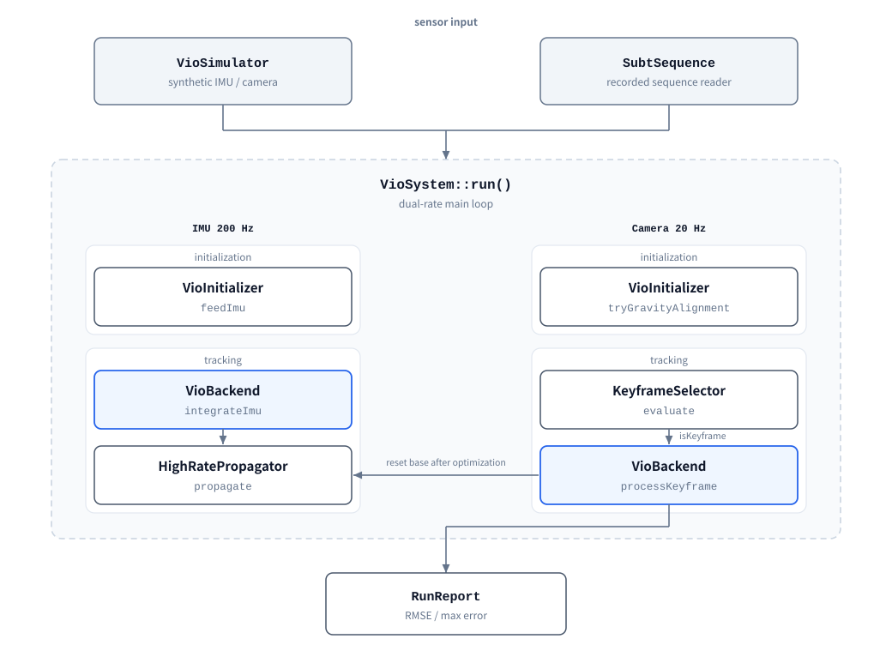

# myslam

English | [简体中文](README_zh.md)

Visual-inertial odometry (VIO) in C++26. The backend uses GTSAM's
`IncrementalFixedLagSmoother` to solve IMU preintegration factors and visual reprojection factors
in a single factor graph, marginalizing states that leave the time window.

- **Language standard**: C++26 (enforced by CMake)
- **Dependencies**: [GTSAM](https://github.com/borglab/gtsam) 4.3, [mylog](https://github.com/printf033/mylog),
  [OpenCV](https://github.com/opencv/opencv) 4.x and [MASt3R](https://github.com/naver/mast3r) (all git submodules)
- **Optional**: LuaJIT 2.1 (configuration); a system OpenCV 4 install as an alternative to the bundled submodule
- **Version**: single source is `project(VERSION)` in `CMakeLists.txt`; read at runtime via `myslam::kVersion`

---

## Contents

- [Architecture](#architecture)
- [Data flow](#data-flow)
- [Module responsibilities](#module-responsibilities)
- [Execution flow](#execution-flow)
- [Repository layout](#repository-layout)
- [Requirements](#requirements)
- [Building](#building)
- [Running](#running)
- [Configuration](#configuration)
- [Dataset replay](#dataset-replay)
- [Scripts](#scripts)
- [Tests](#tests)
- [Engineering conventions](#engineering-conventions)
- [Current limitations](#current-limitations)

---

## Architecture

The system has five parts, listed in call order:

1. **Initializer** `VioInitializer` — state machine `UNINITIALIZED → STATIONARY_COLLECTING →
   GRAVITY_ALIGNED → TRACKING_OK`, with `LOST_DEGRADED` on anomaly (which rebuilds the pipeline).
   Stationarity is decided from both accelerometer and gyro standard deviation with thresholds
   scaled by the configured noise density and sample rate; gyro bias calibration runs after gravity
   alignment, producing the initial pose, velocity, and bias. If `system.initTimeout` elapses without
   meeting the stationarity test, alignment relaxes to the non-stationary path, where the mean
   angular rate contains real motion and is therefore not used as a gyro bias prior (it is zeroed
   and left to the backend's online estimation).
2. **Keyframe decision** `KeyframeSelector` — decides whether the current camera frame becomes a
   keyframe, using average parallax, feature retention, and a time-based fallback. The fallback
   additionally requires a minimum triangulation parallax.
3. **Backend** `VioBackend` — combines `CombinedImuFactor` (IMU preintegration) with
   `ProjectionFactor` (visual reprojection) and solves through `IncrementalFixedLagSmoother` over
   the `slidingWindowLag` window, marginalizing states that leave it. Visual residuals use a Huber
   kernel.
4. **Propagator** `HighRatePropagator` — propagates state between optimizations at the IMU rate and
   resets its base to the optimized state after each optimization.
5. **Health monitor** `HealthMonitor` — checks bias magnitude, speed magnitude, and active
   observation count, returning alert text when a threshold is exceeded.

The simulation and recorded-dataset paths reuse all of the above; only the sensor source changes.

## Data flow



The two columns are the two sample rates. Each column is split into an initialization stage and a
tracking stage; within a column the stages are selected by the current `SystemState` and are
mutually exclusive. Blue boxes are the same `VioBackend` instance invoked on both rate paths.

The main loop is driven by `VioSystem::run()`: time advances by the IMU step, each IMU sample
updates preintegration or propagation, camera frames trigger initialization or keyframe decisions,
and a keyframe triggers backend optimization followed by a propagator reset.

## Module responsibilities

| Module | Responsibility |
| :--- | :--- |
| `vio/configHolder.hpp` | Sensor structs (`ImuMeasurement` / `CameraFrame` / `FeatureObservation`) and `VioConfig` |
| `vio/initializer.hpp` | `SystemState` state machine, stationarity detection, gravity alignment, bias calibration |
| `vio/keyframe_selector.hpp` | Keyframe decision returning `DecisionResult` (flag, reason, parallax, retention) |
| `vio/backend.hpp` | Factor graph construction, triangulation, layered outlier gating, marginalization, `latestNavState()` |
| `vio/propagator.hpp` | IMU-rate state propagation and base reset |
| `vio/health_monitor.hpp` | Bias, speed, and observation-count checks returning `HealthReport` |
| `vio/simulator.hpp` | 3D trajectory and IMU / camera observation generation with analytic ground truth |
| `vio/system.hpp` | Dual-rate main loop orchestration, `SystemConfig`, accuracy evaluation |
| `vio/vio.hpp` | Umbrella header including all of the above |
| `lua_config.hpp` | Lua configuration loading producing `ProjectConfig` |
| `log_config.hpp` | Thin wrapper over the mylog C++ API (level + file output) |
| `dataset/configHolder.hpp` | Replay configuration and statistics structs; standard library only, no OpenCV |
| `dataset/intrinsics_file.hpp` | Parser for intrinsics estimated by external tools such as MASt3R (standard library only) |
| `dataset/subt_dataset.hpp` | SubT sequence reader: IMU CSV, camera timestamps, image index |
| `dataset/mei_tracker.hpp` | MEI model distortion correction and GFTT + LK optical-flow tracking |
| `dataset/dataset_runner.hpp` | Recorded-sequence replay orchestration reusing the VIO components |
| `dataset/visualizer.hpp` | OpenCV window and video output |
| `dataset/ply_export.hpp` | Export landmarks and trajectory as PLY |

`vio/*` and `dataset/configHolder.hpp` include no OpenCV headers, so the project still builds and parses
its configuration when the dataset tools are disabled.

## Execution flow

### Initialization

`VioInitializer::feedImu()` accumulates stationary samples and tracks accelerometer and gyro
standard deviation. Once the samples qualify, `tryGravityAlignment()` derives roll/pitch from the
mean specific force, estimates bias from the mean gyro reading, and returns a `Rot3` plus
`ConstantBias`. On success `VioSystem` calls `VioBackend::initializeSystem()` to install the first
prior and sets the state to `TRACKING_OK`.

### Keyframes and the backend

When a keyframe is accepted, `VioBackend::processKeyframe()` performs:

1. Triangulates new landmarks from feature correspondences between the previous and current
   keyframe, skipping points below `minTriangulationParallaxPx`, and rejects triangulations whose
   depth falls outside `[minLandmarkDepth, maxLandmarkDepth]`;
2. Computes reprojection residuals against the preintegrated predicted pose, temporarily rejecting
   observations above `maxReprojectionErrorPreopt`. The depth interval is enforced here for every
   landmark, unconditionally — it is a geometric-validity test, not an outlier test, so it is not
   exempted by the `landmarkGateWarmupObs` grace period. A single landmark behind the camera has a
   projection Jacobian that diverges as 1/z and is enough to make the Hessian singular;
3. If fewer than `minVisualFactorsForHealth` visual factors survive **and** the recent IMU window
   indicates the device is stationary, injects a zero-velocity prior (ZUPT, `zuptWindowSeconds`,
   `zuptVelocitySigma`). Visual loss leaves only the IMU chain, which constrains how velocity
   *changes* but not velocity itself, so integration error accumulates and position grows
   quadratically;
4. Inserts `ProjectionFactor`s and runs the smoother update, with `extraSmootherIterations`
   additional iterations. If the solve throws `IndeterminateSystemException`, the backend rebuilds
   the smoother around the last successful keyframe instead of propagating the failure: the
   coordinate frame is preserved and only that keyframe is skipped;
5. Recomputes residuals against the optimized pose: observations above `maxReprojectionError` are
   marked as outliers after a multi-frame streak, and those above `maxReprojectionErrorHard` are
   rejected on a single frame;
6. Runs `HealthMonitor` and records any alert. A `VISUAL` degradation (observation starvation, e.g.
   the image going dark) does **not** rebuild the pipeline — the next frame would be just as dark,
   and rebuilding only resets the coordinate frame repeatedly. Inertial degradations do rebuild.

Keyframe data also maintains sliding-window size statistics and the fixed-lag duration
`slidingWindowLag`.

### Accuracy evaluation

`VioSystem::evaluate()` computes translation error per keyframe against simulated ground truth and
reports RMSE and maximum error. RMSE below `rmseThreshold` is reported as passing.

---

## Repository layout

```
myslam/
├── CMakeLists.txt            # top-level build, single version source, format targets
├── config/config.lua         # default runtime configuration (copied into build/config/)
├── src/
│   ├── CMakeLists.txt        # INTERFACE targets myslam / myslam_lua / myslam_sanitized
│   ├── myslam.hpp.in         # version template expanded by configure_file
│   ├── lua_config.hpp        # Lua configuration loading
│   ├── log_config.hpp        # logging configuration
│   ├── vio/                  # VIO core, no OpenCV dependency
│   └── dataset/              # dataset replay, OpenCV confined to this layer
├── examples/
│   ├── 1_visual_inertial_odometry.cpp   # synthetic run example
│   └── 2_subt_dataset.cpp               # recorded dataset replay
├── tests/
│   ├── test_vio.cpp          # VIO smoke test with accuracy assertions
│   └── test_lua_config.cpp   # parsing, clamping, cross-validation, failure paths
├── docs/
│   ├── architecture.svg      # architecture diagram (English)
│   └── architecture_zh.svg   # architecture diagram (Chinese)
├── scripts/
│   ├── run_subt.sh           # dataset replay script
│   ├── plot_tum.py           # TUM trajectory plotting
│   ├── gen_architecture_svg.py  # generates the diagrams under docs/
│   └── setup-hooks.sh        # install the pre-commit formatting hook
└── thirdparty/              # gtsam / mylog / opencv / mast3r (git submodules)
```

---

## Requirements

| Item | Requirement |
| :--- | :--- |
| CMake | ≥ 3.20 |
| Compiler | Accepts `-std=c++26` (GCC 14+) |
| Build tool | Ninja or Make |
| System libraries | TBB, Boost, Eigen3, Threads |
| LuaJIT | 2.1+, discoverable via `pkg-config`; when missing, Lua support is turned off automatically |
| MASt3R | Only for `--init mast3r`: a PyTorch environment plus the checkpoint; otherwise unused |
| OpenCV | 4.x, only when `MYSLAM_BUILD_DATASET_TOOLS=ON`; taken from the system by default, or built from `thirdparty/opencv` with `MYSLAM_USE_BUNDLED_OPENCV=ON` |
| clang-format | 23.1.3 (commit hook and CI both check against this version) |

Install on Ubuntu:

```bash
sudo apt-get install -y build-essential cmake ninja-build pkgconf \
    libtbb-dev libboost-all-dev libeigen3-dev libluajit-5.1-dev
# dataset tools only (system OpenCV backend; skip it for MYSLAM_USE_BUNDLED_OPENCV)
sudo apt-get install -y libopencv-dev
# formatter
pipx install "clang-format==23.1.3"
```

---

## Building

```bash
git clone --recursive <repo-url> myslam
cd myslam

cmake -B build -G Ninja \
    -DCMAKE_BUILD_TYPE=Debug \
    -DCMAKE_EXPORT_COMPILE_COMMANDS=ON

cmake --build build -j"$(nproc)"
ctest --test-dir build --output-on-failure
```

The first build compiles GTSAM. Core-only builds can skip the ~225 MB of
`thirdparty/opencv` + `thirdparty/mast3r` with
`git submodule update --init thirdparty/gtsam thirdparty/mylog`.

### Build options

| Option | Default | Description |
| :--- | :--- | :--- |
| `MYSLAM_BUILD_EXAMPLES` | `ON` when top-level | Build example programs |
| `MYSLAM_BUILD_TESTS` | `ON` when top-level | Build tests |
| `MYSLAM_BUILD_DATASET_TOOLS` | `OFF` | Build the OpenCV dataset replay tools |
| `MYSLAM_USE_BUNDLED_OPENCV` | `OFF` | Build OpenCV from `thirdparty/opencv` instead of using system packages |
| `MYSLAM_SANITIZE` | `ON` when top-level | Enable ASan/UBSan in Debug |
| `MYSLAM_ENABLE_LUA` | `ON` | Lua configuration support; falls back to `OFF` with a warning when LuaJIT is missing |

When included via `add_subdirectory`, these options default to `OFF`.

### Separate build for dataset tools

Under Debug + ASan, keyframe optimization is slow, so dataset replay uses a separate Release tree:

```bash
cmake -B build-release -G Ninja \
    -DCMAKE_BUILD_TYPE=Release \
    -DMYSLAM_SANITIZE=OFF \
    -DMYSLAM_BUILD_TESTS=OFF \
    -DMYSLAM_BUILD_DATASET_TOOLS=ON
cmake --build build-release --target 2_subt_dataset -j"$(nproc)"
```

`scripts/run_subt.sh` defaults to `build-release`.

### Bundled OpenCV

`thirdparty/opencv` is a tracked submodule pinned to the 4.x branch, so the dataset tools can build
against a version that evolves with this repository instead of the host distribution:

```bash
cmake -B build-release -G Ninja \
    -DCMAKE_BUILD_TYPE=Release \
    -DMYSLAM_SANITIZE=OFF \
    -DMYSLAM_BUILD_TESTS=OFF \
    -DMYSLAM_BUILD_DATASET_TOOLS=ON \
    -DMYSLAM_USE_BUNDLED_OPENCV=ON
cmake --build build-release --target 2_subt_dataset -j"$(nproc)"
```

Only the modules the replay tools need are configured (`core`, `imgproc`, `imgcodecs`,
`features2d`, `video`, `calib3d`, `highgui`, `videoio`), with tests, samples, Python/Java bindings
and the optional codecs (JPEG2000, TIFF, OpenEXR, GDAL, gPhoto2) disabled. The first configure
builds those modules from source, so expect a longer compile than the system-package backend.

Both backends expose the same `myslam::opencv` interface target; consumers do not care which one is
active. Follow upstream with `git submodule update --remote thirdparty/opencv`.

### MASt3R

`thirdparty/mast3r` pins [naver/mast3r](https://github.com/naver/mast3r), the reconstruction stack
behind the SubT sequences. It is a Python/PyTorch project, so it takes no part in the C++ build — but
it is an optional **runtime** dependency: `2_subt_dataset --init mast3r` calls
`scripts/mast3r_intrinsics.py` to estimate intrinsics from the images (see
[Where the intrinsics come from](#where-the-intrinsics-come-from)). Without that flag it is never
touched.

Update it with `git submodule update --remote thirdparty/mast3r`. Estimation also needs the nested
dust3r checkout: `git submodule update --init --recursive thirdparty/mast3r`.

### Version

The version string appears once, in `project(VERSION ...)`; `configure_file` writes it to
`<build>/src/generated/myslam.hpp`. Rebuild after changing it.

### Formatting

```bash
cmake --build build --target format        # reformat in place
cmake --build build --target format-check  # check only
```

`scripts/setup-hooks.sh` installs a pre-commit hook that rejects unformatted code.

---

## Running

### Simulation

```bash
cd build
./bin/1_visual_inertial_odometry
```

Runs five seconds of simulation with default configuration (IMU 200 Hz / camera 20 Hz) and prints:

```
评估关键帧样本数 : 24
整体平移 RMSE 误差: 0.0365 米
最大轨迹偏差       : 0.0778 米
```

Exit code `0` means RMSE is below `system.rmseThreshold` (default 0.20 m).

Logs are written to a `.log` file in the **current working directory** (managed by mylog's
`FileManager`); the terminal only prints `[info] 已加载配置: ...`. Open the log file for results.

### Explicit configuration

```bash
./bin/1_visual_inertial_odometry                  # reads config/config.lua, else built-in defaults
./bin/1_visual_inertial_odometry my_config.lua    # explicit; exit code 1 on load or validation failure
```

---

## Configuration

Runtime parameters come from a Lua script, by default `config/config.lua`, copied into
`build/config/` at configure time.

### Sections

| Section | Consumer | Contents |
| :--- | :--- | :--- |
| `vio` | `VioConfig` | camera intrinsics, extrinsics, IMU noise, Huber kernel threshold, keyframe policy, sliding window |
| `system` | `SystemConfig` | camera step, run duration, RMSE threshold |
| `dataset` | `MeiIntrinsics` / `DatasetRunConfig` | dataset intrinsics, replay range, visualization switches |
| `logger` / `fileManager` | mylog | log level, buffers, rotation and retention |

Every field may be omitted; omission keeps the built-in default.

### Loading mechanism

- The script runs in a bare `lua_State` with no standard libraries registered, so
  `io`/`os`/`package`/`debug` are unavailable. An instruction budget (`kInstructionBudget`,
  50 million) is set as a hook.
- Values are parsed into a temporary copy and written back to `ProjectConfig` only after all
  validation passes; any failure leaves the caller's configuration unchanged.
- Out-of-range values are handled two ways: tuning fields are clamped into a safe interval with a
  warning; hard prerequisites such as focal length, pinhole scale, and image dimensions are
  rejected instead of corrected.
- Unregistered keys inside a section are reported individually.
- Cross-field constraints are checked: keyframe interval bounds, relative ordering of reprojection
  thresholds, and the camera/IMU rate relationship.

### Derived quantity

The IMU sampling step is not a configuration field; it derives from `vio.imuRateHz`:

```cpp
const double imuDt = vio::SystemConfig::imuDtFrom(config_.imuRateHz);  // 1 / imuRateHz
```

A leftover `system.imuDt` in an older config produces a migration message.

### Loading from code

```cpp
#include "lua_config.hpp"

myslam::config::ProjectConfig project;
const auto result = myslam::config::load("config/config.lua", project, /*applyLogging=*/true);

if (!result) { /* keep built-in defaults; result.error().message explains why */ }
else if (!result->logging) { /* fall back to the mylog C++ API */ }
```

Without linking `myslam::myslam_lua`, the header is a stub whose `load()` returns failure.

---

## Dataset replay

`2_subt_dataset` uses the same VIO components as the simulator; only the sensor source changes.
Expected layout:

```
Handheld1_Folder/
├── cam_0/
│   ├── 0.png, 1.png, ...
│   └── timestamps.txt      # one nanosecond timestamp per line
└── imu/
    └── imu_data.csv        # timestamp, q_x, q_y, q_z, q_w,
                            # ang_vel_{x,y,z}, lin_acc_{x,y,z}
```

### Handling specific to this dataset

**MEI camera model**: the backend reprojects through `gtsam::Cal3_S2`, while the sequence uses the
MEI model. `MeiFeatureTracker` first inverts the radtan distortion, then back-projects to a ray
under the MEI model, and finally projects through virtual pinhole intrinsics scaled by
`pinholeScale`. The virtual intrinsics are mirrored into `VioConfig`.

**IMU timestamp gaps**: consecutive samples separated by more than
`maxImuGapFactor / imuRateHz` are treated as a gap (default 10 sample periods, i.e. 50 ms at
200 Hz; adjustable via `dataset.replay.maxImuGapFactor`). Two rules apply:

- Zero-order hold never spans a gap: there is no IMU data inside it, so integration stops one
  sample period after the last valid sample instead of extrapolating across the missing time;
- The pipeline is rebuilt and re-initialized. Segment count is reported in
  `DatasetRunReport::segments`, resets in `resets`.

Each segment re-initializes from a local origin, so their coordinate frames differ and
**trajectories and point clouds must not be concatenated across segments**. The TUM output marks
segment boundaries with `#` comment lines (`plot_tum.py` skips them), and the report warns when
there is more than one segment.

The preintegration boundary is aligned to the camera timestamp: a camera time usually falls
between two IMU samples, so integration is truncated proportionally at `cameraTime`, and the
straddling sample is only partially consumed with its remainder left for the next frame. The
interval covered by `CombinedImuFactor` therefore ends exactly at the keyframe timestamp.

### Usage

```bash
build-release/bin/2_subt_dataset \
    --data  /path/Handheld1_Folder/cam_0 \
    --imu   /path/Handheld1_Folder/imu/imu_data.csv \
    --stamps /path/Handheld1_Folder/cam_0/timestamps.txt \
    [--output traj.tum] [--start-frame N] [--max-frames N] [--stride N] \
    [--max-features N] [--max-duration S] [--ply cloud.ply] \
    [--viz] [--video out.mp4] [--viz-stride N] [--viz-rate R] \
    [--config config/config.lua] \
    [--init manual|mast3r] [--intrinsics-file FILE]
```

`--config` supplies baseline defaults; command-line arguments take precedence. When omitted, it
reads `config/config.lua` in the current directory, else uses built-in defaults.

`--fx/--fy/--cx/--cy/--xi/--k1/--k2/--p1/--p2/--width/--height/--pinhole-scale` override MEI
intrinsics individually.

### Where the intrinsics come from

Sequences that ship no calibration file can skip the camera parameters entirely and let MASt3R
estimate them from the images:

```bash
scripts/run_subt.sh --init mast3r          # or 2_subt_dataset ... --init mast3r
```

How it works:

1. Six image pairs by default (`--mast3r-pairs`) are fed to the MASt3R model in
   `thirdparty/mast3r`; a focal length is recovered from the predicted point maps with
   `estimate_focal_knowing_depth`, the principal point is taken as the image centre;
2. the result is written to `<cam_0>/../mast3r_intrinsics.txt` and cached, so later replays skip the
   inference; `--force-estimate` recomputes it and `--mast3r-cache` relocates it;
3. the parser uses it for the **virtual pinhole focal** only: `pinholeScale = focal / fx` so the
   backend's `pinholeFx()` equals the estimate. `xi` and `k1/k2/p1/p2` are **inherited from the
   configured calibration**, so the fisheye unprojection still runs.

#### Why the estimate must not be written as `fx`

The estimate is an *effective pinhole focal length* fitted under a pinhole assumption, while the MEI
`fx` is a projection parameter: Handheld1 has `fx = 758.3` with `xi = 1.583`, whose paraxial
pinhole focal is only `fx / (1 + xi) ≈ 294`. An earlier revision stored `focal = 408` into `fx`
and zeroed `xi`, which is equivalent to treating the raw fisheye frame as a pinhole image:
`mx/mz = x` degenerates the pixel mapping to identity and bypasses distortion inversion, moving
the valid-field mask from 54.7% to 99.8%. The **circular mechanical rim** of a fisheye lens is a
high-contrast corner magnet, so GFTT piled features onto the rim, optical flow spent its tracking
budget on edges that cannot be triangulated, and the trajectory scale came out more than 2× too
large. Keeping `xi` lets `meiToPinhole`'s `mz <= 1e-6` and bounds checks reject the rim again.

Inference needs a PyTorch environment: point `--python`, `MYSLAM_PYTHON` or the script's
`MAST3R_PYTHON` at it (the conda `mast3r` env works), and pass the checkpoint with
`--mast3r-weights` or `MAST3R_WEIGHTS`; by default it is looked up under
`thirdparty/mast3r/checkpoints/`.

Two limits worth knowing:

- MASt3R predicts a **pinhole** model, so on a >180° MEI fisheye it only yields an approximate
  focal (Handheld1 lands anywhere in 400–500 px). It cannot recover `xi` or the distortion terms,
  so a new sequence's lens characteristics still belong in `dataset.intrinsics`, and accuracy
  evaluation still needs the yaml calibration;
- estimation covers the focal length only. The camera-IMU extrinsic `Tic` likewise still comes from
  the built-in value or a calibration file.

Machines that already have an estimate can skip inference with `--intrinsics-file result.txt`
(format documented in `src/dataset/intrinsics_file.hpp`):

```
model = pinhole
source = mast3r
focal = 495.90
cx = 320.0
cy = 240.0
width = 640
height = 480
```

`focal` is the backend's virtual pinhole focal length, not the MEI `fx`. Any `xi`/`k1`/`k2`/`p1`/`p2`
missing from the file is inherited from the configuration; writing `fx`/`fy` is rejected outright,
which also invalidates caches produced by the earlier revision so they get recomputed.

### Visualization

- `--viz`: OpenCV window (needs `DISPLAY`, ESC/q to quit)
- `--video FILE`: encode to video (falls back to `.avi`/MJPG when mp4 is unavailable)
- `--viz-rate R`: `0` full speed, `1` real time, `2` double speed

Layout: the top-left panel is the raw fisheye image with features in raw pixel coordinates and a
cyan outline of the usable MEI field of view; the top-right panel is the same frame warped into the
virtual pinhole image the tracker works in, with features in pinhole coordinates. The bottom status
bar holds a trajectory minimap on the left and status text on the right. Green = tracked from the
previous frame, orange = newly detected.

The undistorted view shares the virtual pinhole intrinsics used for reprojection (`pinholeScale`
times the focal length); its black border is the part of the pinhole canvas the fisheye frame does
not cover. It is a reference view: tracked features already live in that canvas, so drawing them on
the raw fisheye image would shift them systematically — each panel uses its own pixel coordinates.
Set `dataset.viz.showUndistorted = false` to drop the right panel (and the per-frame remap).

### Inspecting trajectories

```bash
scripts/plot_tum.py traj.tum --save traj.png          # 3D / XY top-down / position-velocity panels
scripts/plot_tum.py traj.tum --ply cloud.ply --show
```

PLY clouds open in MeshLab / CloudCompare / Open3D.

---

## Scripts

### `scripts/run_subt.sh`

```bash
scripts/run_subt.sh                          # default sequence, starting at frame 2300
scripts/run_subt.sh --max-frames 0           # replay everything remaining
scripts/run_subt.sh --root /path/Handheld2_Folder
scripts/run_subt.sh --viz                    # live window
scripts/run_subt.sh --video out.avi --ply cloud.ply
scripts/run_subt.sh --plot                   # plot the trajectory afterwards
scripts/run_subt.sh --no-build               # skip the build
scripts/run_subt.sh --init mast3r            # estimate intrinsics with MASt3R
```

The default sequence path is `../MASt3R-Fusion/dataset/Handheld1_Folder`, overridable with
`--root` or `SUBT_ROOT`. It starts at frame 2300 (that sequence has exposure jumps and an IMU gap
early on). When `--max-frames` is not given, the script uses `500000`.

`--init mast3r` forwards to the replay tool and sets `MYSLAM_PYTHON` from `MAST3R_PYTHON`, so
the MASt3R inference runs in the interpreter you name.

### `scripts/plot_tum.py`

Requires `numpy` and `matplotlib`. Produces three panels: 3D trajectory, XY top-down, and
position/velocity over time.

### `scripts/setup-hooks.sh`

Installs `.githooks/pre-commit` (`git config core.hooksPath .githooks`), which checks staged files
with `clang-format --dry-run -Werror`.

---

## Tests

```bash
ctest --test-dir build --output-on-failure
```

| Test | Coverage |
| :--- | :--- |
| `myslam_test` | Public API usable, keyframes produced, RMSE within threshold, derived step valid |
| `myslam_config_test` | Parsing, clamping, cross-validation, unknown keys, quaternion normalization, failure paths, logging section effect, default-config self-consistency |
| `myslam_intrinsics_test` | Intrinsics file: focal lands on the virtual pinhole, distortion inherited from the baseline, legacy `fx` fields rejected, principal-point fallback and malformed input rejected |

CI (`.github/workflows/ci.yml`) runs format checking, a build, and the suite on Ubuntu with
`g++-14`, pinning `clang-format` 23.1.3.

---

## Engineering conventions

Conventions come from the mylog submodule; the full statement is in the project's
`instructions.md`.

- C++26, 4-space indent, Allman braces, 120 columns
- Types `CamelCase`; functions and locals `camelBack`; members suffixed `_`
- Constants `k` prefix + `CamelCase`; enums and macros `UPPER_CASE`; namespaces `lower_case`
- Build switches prefixed `MYSLAM_*`; test target `myslam_test`
- Doxygen comments; clang-format required before committing

---

## Current limitations

- No loop closure or global relocalization; error accumulates over time.
- No map persistence; landmarks are reclaimed as the marginalization window advances.
- Monocular camera plus IMU only; no multi-camera, depth, or GNSS fusion.
- No `install()` or `export()` rules. `myslam` is an INTERFACE target, `INSTALL_INTERFACE` is a
  placeholder, and the generated header is not installed.
- Configuration loads once at startup; no runtime hot reload.
- Logs are written to the current working directory rather than a project-managed location.
- If a prefix that shadows the system `libfontconfig` is active (e.g. conda), the dataset tools
  fail at runtime with `undefined symbol: FcConfigSetDefaultSubstitute`; work around it with
  `LD_LIBRARY_PATH=/usr/lib/x86_64-linux-gnu`.
