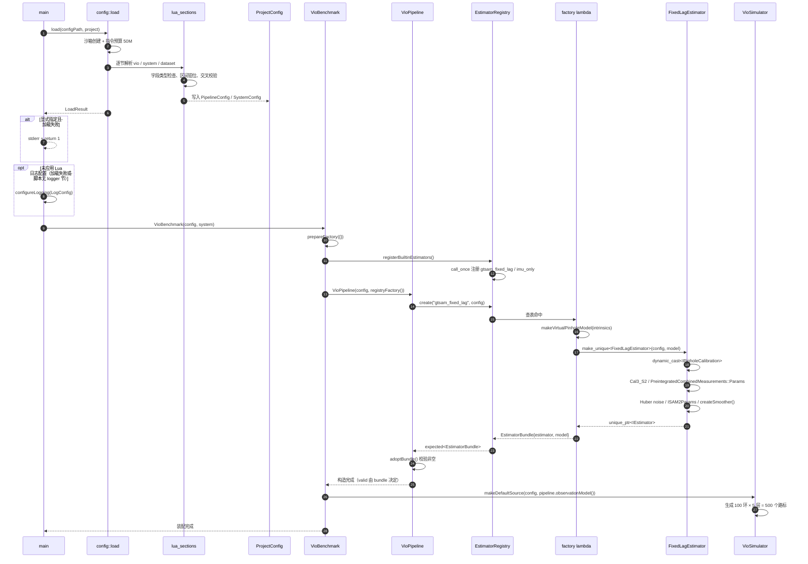
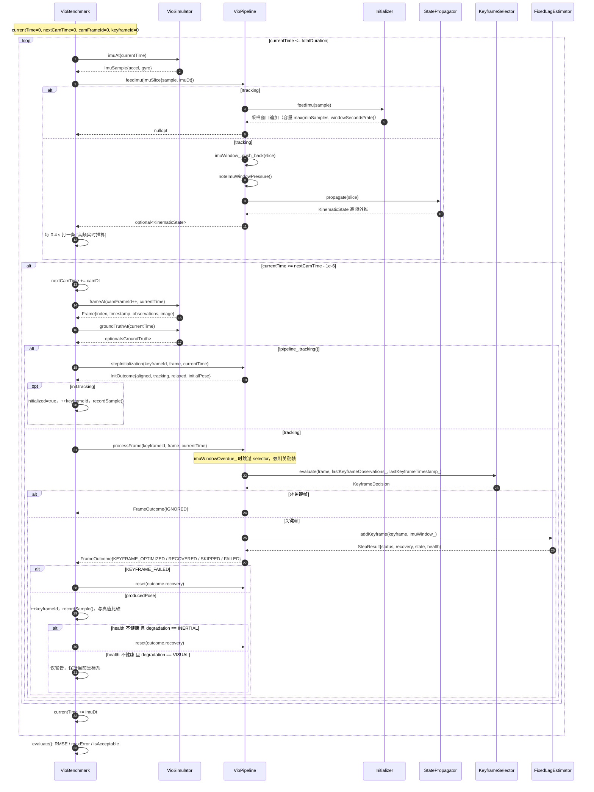
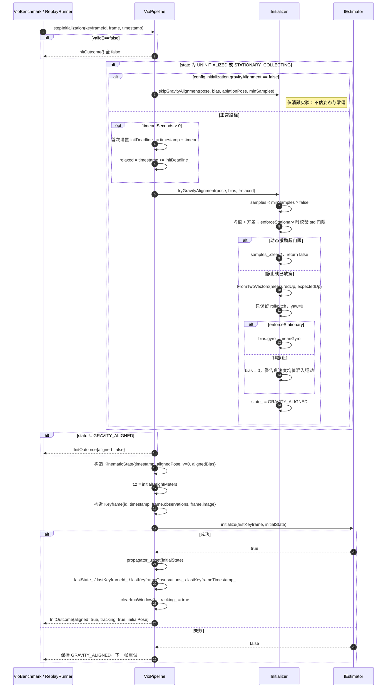
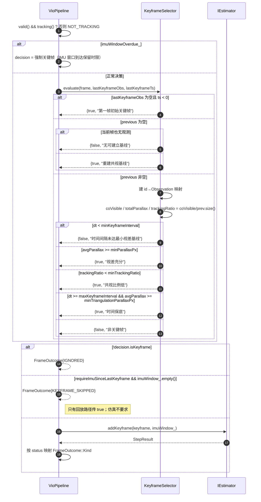
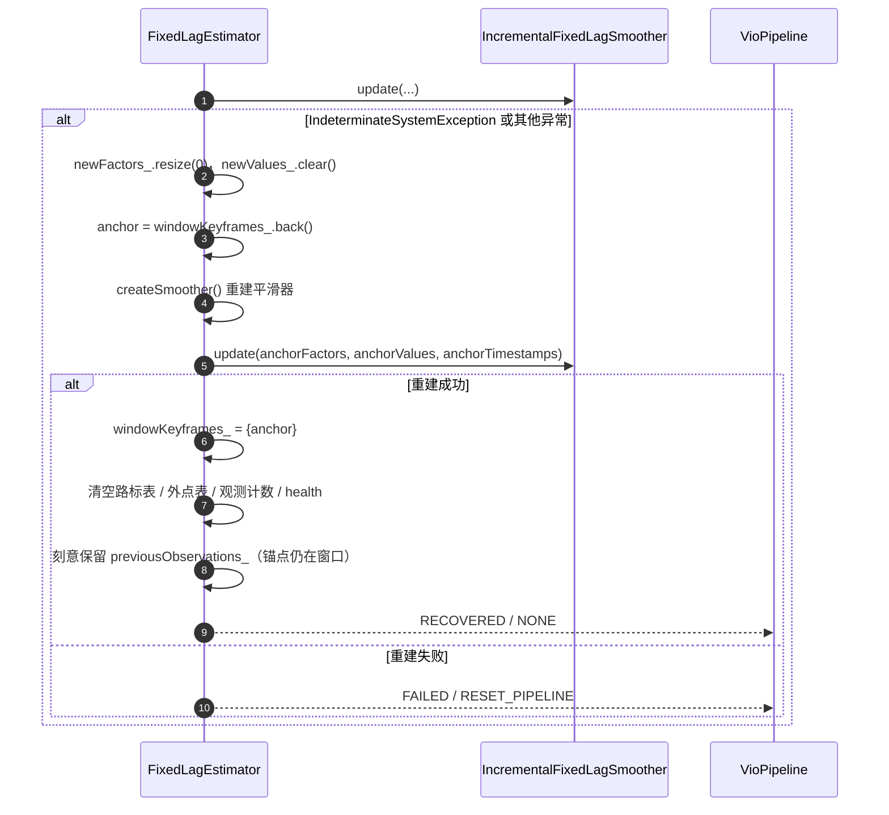
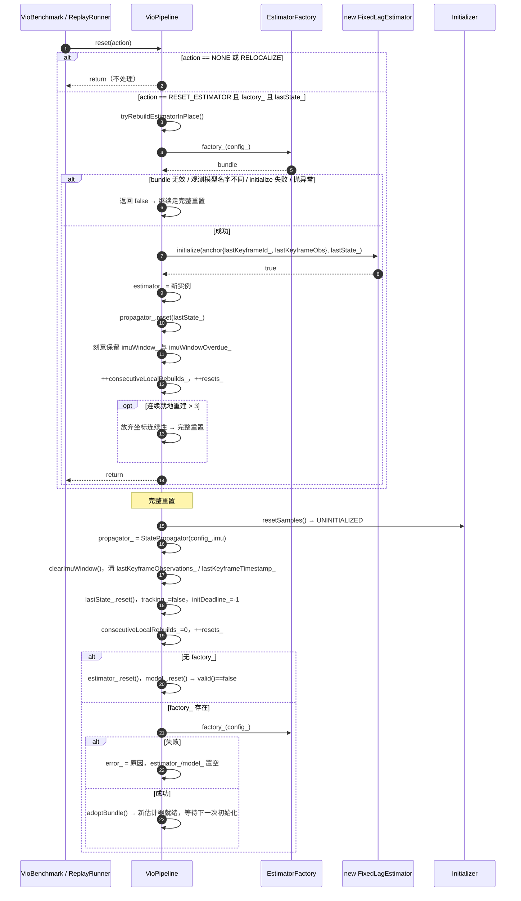
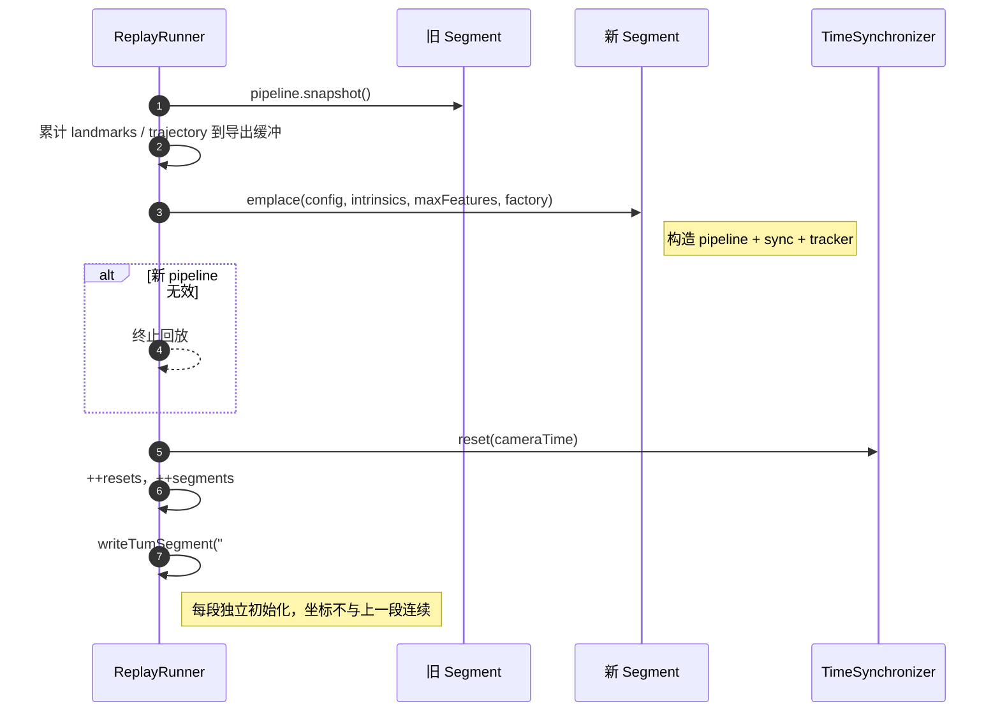

# myslam

C++26 视觉惯性里程计（VIO）。契约归项目所有，求解器只是可替换的插件：`src/domain/` 定义
位姿、观测、关键帧、相机模型与估计器端口，不包含任何第三方估计或视觉库；GTSAM 的
`IncrementalFixedLagSmoother` 是参考后端，位于 `src/adapters/`，与一套纯 IMU 航位推算后端
并列，跑哪一个由配置键决定。

- **语言标准**：C++26（CMake 强制）
- **依赖**：GTSAM 4.3、mylog、OpenCV 4.x、MASt3R（后两者仅数据集回放工具需要）
- **配置**：单个 Lua 文件，运行时参数全部在内，无需命令行开关


## 快速开始

```bash
# 依赖（Ubuntu）
sudo apt-get install -y build-essential cmake ninja-build pkgconf \
    libtbb-dev libboost-all-dev libeigen3-dev libluajit-5.1-dev

# 构建（首次会编译 GTSAM）
git clone --recursive <repo-url> myslam && cd myslam
cmake -B build -G Ninja -DCMAKE_BUILD_TYPE=Debug -DCMAKE_EXPORT_COMPILE_COMMANDS=ON
cmake --build build -j"$(nproc)"
ctest --test-dir build --output-on-failure

# 仿真：5 秒合成轨迹（IMU 200 Hz / 相机 20 Hz），结束时给出与真值对比的 RMSE
./build/bin/1_visual_inertial_odometry

# 数据集回放：Debug + ASan 下每次关键帧优化要数十秒，因此另建 Release 树
cmake -B build-release -G Ninja -DCMAKE_BUILD_TYPE=Release -DMYSLAM_SANITIZE=OFF \
      -DMYSLAM_BUILD_TESTS=OFF -DMYSLAM_BUILD_DATASET_TOOLS=ON
cmake --build build-release --target 2_subt_dataset -j"$(nproc)"
./scripts/run_subt.sh --no-build
```

只有核心层可以跳过 OpenCV 与 MASt3R（约 225 MB）：
`git submodule update --init thirdparty/gtsam thirdparty/mylog`。

## 仓库结构

```
myslam/
├── CMakeLists.txt          # 顶层构建、版本单一来源（project(VERSION)）、格式目标
├── config/config.lua       # 唯一的运行时配置
├── src/
│   ├── domain/             # 契约与值类型：位姿、观测、端口、配置、初始化、时间同步
│   ├── adapters/           # 估计器实现：gtsam 固定滞后、纯 IMU
│   ├── frontend/           # 图像 → 观测（GFTT + 金字塔 LK）
│   │                       #   拆成两个目标：myslam_frontend（接口层，只依赖 domain）
│   │                       #   与 myslam_frontend_cv（OpenCV 光流实现，回放/可视化用）
│   ├── sensor/             # 数据来源：仿真器、数据集读取、标定文件
│   ├── pipeline/           # 编排核心，只依赖 domain
│   ├── app/                # 两个入口：VioBenchmark（有真值，打分）、ReplayRunner（只统计）
│   ├── viz/                # 窗口、去畸变图、观察者实现
│   ├── common/ config/     # 非算法数据、Lua 解析
│   ├── vio.hpp             # 聚合头
│   ├── log_config.hpp      # mylog 日志级别与文件输出封装（logger/fileManager 两节）
│   └── myslam.hpp.in       # 版本头模板，构建时由 project(VERSION) 生成 myslam.hpp
├── examples/               # 1_visual_inertial_odometry / 2_subt_dataset
├── tests/                  # test_vio / test_lua_config / test_intrinsics_file
├── docs/                   # 架构图、ADR、本文档
├── scripts/                # run_subt.sh / run_rosbag.sh / run_tum.sh / check_layers.py / plot_tum.py
└── thirdparty/             # gtsam / mylog / opencv / mast3r（submodule）
```

依赖方向由 CMake 分层目标与 `scripts/check_layers.py` 双向强制：

```
domain ← common/config/sensor/frontend/adapters ← pipeline ← app ← viz
```

`myslam::pipeline` 既不链接 GTSAM 也不链接 OpenCV。五个可替换端口
（`IEstimator` / `IObservationExtractor` / `ICameraModel` / `IStatePropagator` /
`ISensorSource`）及其实现见下文「经过多少种类」。

## 架构

下面按「一次请求经过哪些层」展开，所有内容与源码逐函数对应。

### 仿真路径（`VioBenchmark`）

```
L0   examples/1_visual_inertial_odometry.cpp :: main
       │  config::load -> ProjectConfig{vio, system}
       │  VioBenchmark(config, system)
       ▼
L1   vio::VioBenchmark::run()                      ← 编排：时间轴、真值配对、RMSE
       │  source_->imuAt(t)                        [每 5 ms]
       │  source_->frameAt(frameId, t)             [每 50 ms]
       ▼
L2   vio::VioPipeline::feedImu / stepInitialization / processFrame
       │  ├─ domain::Initializer::feedImu / tryGravityAlignment      [状态机]
       │  ├─ domain::StatePropagator::propagate                     [高频外推]
       │  └─ domain::KeyframeSelector::evaluate                     [关键帧决策]
       ▼
L3   domain::IEstimator（端口，纯虚）                 ← 唯一求解器入口
       │  虚分派：initialize / addKeyframe / latestState / snapshot
       ▼
L4   adapters::FixedLagEstimator                   ← 参考后端
       │  ├─ domain::HealthMonitor::inspect
       │  ├─ domain::ICameraModel::project（观测模型）
       │  └─ gtsam 类型转换 adapters::toGtsam/fromGtsam
       ▼
L5   gtsam::IncrementalFixedLagSmoother (iSAM2)
       │  update() / calculateEstimate()
       ▼
L6   Gauss-Newton on Bayes tree（CHOLESKY）
```

横切：`mylog`（`logger.hpp`）在 L0–L5 每一层都有调用；不进入算法分支。

### 回放路径（`ReplayRunner`）

回放比仿真多两级——**时间同步**和**特征提取**，因为真实数据不满足「按时间点查询」的假设：

```
L0   examples/2_subt_dataset.cpp :: main
       │  SubtSequence::load() → stamps_ / imu_（相对秒）
       │  ReplayRunner(config, intrinsics, runConfig, observer)
       ▼
L1   dataset::ReplayRunner::run(sequence)
       │  cv::imread → domain::ImageView → domain::Frame
       ▼
L2   domain::TimeSynchronizer::push / advanceTo     ← 零阶保持 + 断档检测 + 时间偏移
       │  输出 vector<ImuSlice>（dt 已截断到相机时刻）
       ▼
L3   vio::MeiFeatureTracker::extract                 ← GFTT + 金字塔 LK
       │  mapPixel: source_->unproject → target_->project
       ▼
L4   vio::VioPipeline::feedImu / stepInitialization / processFrame
       │  └─ domain::KeyframeSelector::evaluate
       ▼
L5   domain::IEstimator（端口）
       ▼
L6   adapters::FixedLagEstimator
       ▼
L7   gtsam::IncrementalFixedLagSmoother
```

### 经过多少种类

**端口（可替换缝）**：5 个；对应 6 个接口——`IPinholeCalibration` 是 `ICameraModel` 的能力接口，不单独构成一条缝。全部定义在 `src/domain/ports.hpp` 与 `src/domain/camera_model.hpp`。

| 端口                                        | 实现                                                                               | 职责                                |
| :------------------------------------------ | :--------------------------------------------------------------------------------- | :---------------------------------- |
| `domain::IEstimator`                      | `FixedLagEstimator`（`gtsam_fixed_lag`）、`ImuOnlyEstimator`（`imu_only`） | 关键帧 + IMU 窗口 → `StepResult` |
| `domain::IObservationExtractor`           | `MeiFeatureTracker`                                                              | 图像 → 带跨帧 ID 的观测            |
| `domain::ICameraModel`                    | `PinholeCameraModel`、`MeiCameraModel`                                         | 像素 ↔ 射线                        |
| `domain::IPinholeCalibration`（能力接口） | `PinholeCameraModel`                                                             | 供只做针孔重投影的估计器查询        |
| `domain::IStatePropagator`                | `StatePropagator`                                                                | 优化之间的 IMU 速率外推             |
| `domain::ISensorSource`                   | `VioSimulator`                                                                   | 仿真/离线查询式数据源               |

（`ICameraModel` 与 `IPinholeCalibration` 在同一层，故上表 6 行对应 5 个「可替换缝」：估计器、前端、相机模型、外推器、数据源。）

**一条仿真关键帧实际实例化的组件种类（按调用顺序）**：

1. `VioBenchmark`（编排）
2. `VioSimulator`（`ISensorSource`）
3. `VioPipeline`（流水线）
4. `KeyframeSelector`（决策）
5. `IEstimator` 端口 → `FixedLagEstimator`（适配器）
6. `HealthMonitor`（领域服务）
7. `ICameraModel`（投影；gtsam 后端下是虚拟针孔）
8. `PreintegratedCombinedMeasurements`（GTSAM）
9. `CombinedImuFactor` / `GenericProjectionFactor` / `PriorFactor`（GTSAM）
10. `IncrementalFixedLagSmoother` + `ISAM2`（GTSAM）
11. `mylog`（横切）

**一条回放关键帧额外经过**：

12. `SubtSequence`（数据读取）
13. `TimeSynchronizer`（同步）
14. `MeiFeatureTracker`（前端）
15. `PinholeCameraModel` / `MeiCameraModel`（源模型与目标模型各一个）
16. `ReplayObserver` → `MeiUndistorter` → `DatasetVisualizer`（可选显示）
17. `io::writePly` / `std::ofstream`（TUM 轨迹）

**层级计数**（按调用跳数计，即参与的类数 − 1，与上一节的 `L0..L6` 编号同一套口径）：

- IMU 切片（初始化期）：`run → feedImu → Initializer`，2 跳。
- IMU 切片（追踪期）：`run → feedImu → StatePropagator`，另加 `noteImuWindowPressure`，2 跳。
- 相机非关键帧（仿真）：`run → processFrame → KeyframeSelector`，2 跳（`processFrame` 自身算起点）。
- 相机关键帧（仿真）：`run → processFrame → KeyframeSelector → IEstimator → FixedLagEstimator → GTSAM`，5 跳。
- 相机关键帧（回放）：`run → MeiFeatureTracker → processFrame → KeyframeSelector → IEstimator → FixedLagEstimator → GTSAM`，6 跳；再加上同步器与观察者两条支路。

## 启动与装配

配置在进入算法前一次性完成解析；装配阶段决定「哪个估计器、哪个相机模型、哪个数据源」。**未知估计器名在装配期失败**，不静默回退。



关键点：

- `registerBuiltinEstimators()` 用 `std::call_once`，重复调用幂等（`src/adapters/register_builtin.hpp:31`）。
- 工厂返回 `std::expected<EstimatorBundle, std::string>`；失败原因带「已注册名字列表」（`src/domain/registry.hpp:58`）。
- 工厂同时产出**估计器**与**观测模型**。`gtsam_fixed_lag` 只做针孔重投影，因此选择 `makeVirtualPinholeModel`（对 MEI 构造 `PinholeCameraModel`：焦距经 `pinholeFx()/pinholeFy()` 乘 `pinholeScale` 折算，主点 `pinholeCx()/pinholeCy()` **不缩放**）；`imu_only` 选择 `makeCameraModel`（原始 MEI 或针孔）。前端与仿真器必须使用同一个模型实例，否则「产生观测的像素语义」与「消费观测的像素语义」会错开。
- `VioPipeline` 构造失败时保留对象但 `valid()==false`，`run()` 直接返回空报告；不存在「半初始化继续跑」。

## 仿真主循环：`VioBenchmark::run()`

时间轴由 IMU 步长推进，相机帧在同一循环里按 `camDt` 触发。**IMU 与相机的相对时序**是本图的核心：



**精确的边界条件**（与代码逐条对应，`src/app/benchmark.hpp:64`）：

1. 相机帧时间戳使用 `currentTime`，不是 `nextCamTime`；`nextCamTime` 只作为触发游标。因为 `imuDt <= camDt`（构造时校验），一帧相机时刻必然落在某个 IMU 步上。
2. 初始化成功后同一帧不再走 `processFrame`（`else` 分支），首帧只注入先验。
3. `keyframeId` 在「初始化成功」和「关键帧成功产出位姿」之后自增；失败/跳过/局部恢复**不**自增，因此编号始终等于「已成功消费的关键帧数」。
4. 视觉降级（`Degradation::VISUAL`）只记录日志，不调用 `reset`；惯性降级才执行估计器建议的动作。
5. `KEYFRAME_FAILED` 无条件按 `outcome.recovery` 处置（`RESET_PIPELINE` 或 `RESET_ESTIMATOR`）。
6. `feedImu` 在追踪期先入窗口再外推，因此外推看到的是同一条切片；优化成功后 `propagator_.reset(optimizedState)` 把外推基线拉回优化值。

## 初始化阶段：`stepInitialization`

初始化的「请求」是**一帧图像 + 已累积的 IMU 样本**。状态机只在 `VioPipeline` 的 `tracking_` 与 `Initializer::state_` 之间推进。



要点：

- 首帧的**观测集合**随先验一起注入（`Keyframe` 而非四个标量），它是第一次三角化的基线；丢掉它会让 KF #1 无法建立路标。
- 静止判定同时看加速度计与陀螺仪标准差，门限按 `noise sigma × sqrt(rate) × 5` 缩放，并有工业下限（0.3 / 0.05）。
- 超时后走「非静止对齐」：只估 roll/pitch，零偏置零，不把运动角速度当零偏先验。
- 初始化未完成时保留采样窗口并下一帧重试；例外是静止检测发现动态激励超门限，此时 `tryGravityAlignment` 会 `samples_.clear()`，重新积累。`tracking_` 始终为 false，因此不会带着空估计器进入追踪。

## 追踪阶段：关键帧决策

`processFrame` 的第一件事是判定「这帧要不要成为关键帧」。判定顺序是精确的，且**时间间隔检查先于视差/共视**。



`StepStatus` → `FrameOutcome::Kind` 的映射（`processFrame` 的 `switch`，`src/pipeline/pipeline.hpp:358`）：

| `StepStatus` | 附加条件     | `FrameOutcome::Kind` | 编排层动作                                            |
| :------------- | :----------- | :--------------------- | :---------------------------------------------------- |
| `OK`         | 有 `state` | `KEYFRAME_OPTIMIZED` | 记录位姿、`++keyframeId`、重置外推基线、清 IMU 窗口 |
| `OK`         | 无 `state` | `KEYFRAME_FAILED`    | `recovery` 强制改为 `RESET_PIPELINE`              |
| `RECOVERED`  | —           | `KEYFRAME_RECOVERED` | 本帧不出位姿，**不更新基线**、不清窗口          |
| `SKIPPED`    | —           | `KEYFRAME_SKIPPED`   | 不产出、不清窗口                                      |
| `FAILED`     | —           | `KEYFRAME_FAILED`    | 按 `recovery`                                       |
| 抛出异常       | —           | `KEYFRAME_FAILED`    | 兜底转 `RESET_PIPELINE`                             |

`OK` 分支的基线更新有一个刻意例外：**空观测的关键帧不覆盖 `lastKeyframeObservations_`**。否则视觉中断期间插入的「只有 IMU 因子」的关键帧会抹掉上一次可比对的特征集合，恢复后既算不出共视率也算不出视差，关键帧再也插不进去。

## 关键帧内部：`FixedLagEstimator::addKeyframe`

这是整条链路最深的一段：一次 `addKeyframe` = **1 段前置校验 + 12 个阶段**（阶段 0 就是前置校验）。按代码顺序：

```mermaid
sequenceDiagram
    autonumber
    participant PIPE as VioPipeline
    participant EST as FixedLagEstimator
    participant PIM as PreintegratedCombinedMeasurements
    participant CAM as ICameraModel
    participant HM as HealthMonitor
    participant SM as IncrementalFixedLagSmoother

    PIPE->>EST: addKeyframe(keyframe, span<ImuSlice>)

    Note over EST: 阶段 0：前置校验
    alt !valid_
        EST-->>PIPE: FAILED / RESET_PIPELINE（相机模型无针孔标定）
    else windowKeyframes_ 为空
        EST-->>PIPE: FAILED / RESET_PIPELINE（缺少 initialize）
    else imu.empty()
        EST-->>PIPE: SKIPPED（无积分区间）
    end

    Note over EST: 阶段 1：批量预积分
    EST->>PIM: make_unique(pim_)(imuParams_, bias)
    loop 每条 ImuSlice
        EST->>PIM: integrateMeasurement(accel, gyro, dt)
        EST->>EST: recentImu_.push_back(sample)
    end
    EST->>EST: 裁剪 recentImu_ 到 zuptWindowSeconds

    Note over EST: 阶段 2：预积分外推 + IMU 因子
    EST->>PIM: predict(latestNavState_, bias)
    PIM-->>EST: propState
    EST->>EST: newValues_ 插入 X/V/B(cur)
    EST->>EST: newFactors_ += CombinedImuFactor(prev, cur, pim_)

    Note over EST: 阶段 3：预优化门控
    Note over EST: 循环内先跳过未三角化 / 已标记外点 / 图中无 L 的观测
    EST->>EST: predCamPose = predBodyPose ∘ bodyPSensor
    loop 每个 Observation
        EST->>CAM: project(ptC)
        CAM-->>EST: optional<Vec2>
        alt 深度越界 / 投影失败
            EST->>EST: gate.geometricallyInvalid.insert(id)
        else warmup 未满 landmarkGateWarmupObs
            EST->>EST: 跳过门控（保护新路标）
        else residualPx > maxReprojectionErrorPreopt
            EST->>EST: gate.outlierCount++
            opt preoptTemporaryRejection
                EST->>EST: gate.gatedOut.insert(id)
            end
        end
    end

    Note over EST: 阶段 4：三角化新路标
    alt currentEstimate_.exists(X(prev)) 且 previousObservations_ 非空
    EST->>EST: tWc1 = X(prev) ∘ bodyPSensor，tWc2 = propPose ∘ bodyPSensor
    loop 当前帧每个未三角化观测
        EST->>EST: 查 previousObservations_ 的同 id 像素
        alt 视差 < minTriangulationParallaxPx
            EST->>EST: 跳过
        else
            EST->>EST: gtsam::triangulatePoint3(cameraPoses, K_, {p1,p2})
            EST->>CAM: project(ptC1) / project(ptC2)
            alt 任一帧投影失败（!uv1 || !uv2）
                EST->>EST: continue（无法验证一致性）
            else 重投影 > maxReprojectionErrorHard
                EST->>EST: 丢弃
            else 两帧深度都在 [minLandmarkDepth, maxLandmarkDepth]
                EST->>EST: triangulatedLandmarks_[id] = ptW
                EST->>EST: landmarkObsCount_[id] = 2（warmup 起点）
                EST->>EST: newValues_ 插入 L(id)
                EST->>EST: newFactors_ += PriorFactor(L(id))
                EST->>EST: newFactors_ += ProjectionFactor(X(prev), L(id), p1)
            end
        end
    end
    else 上一关键帧位姿或观测缺失
        EST->>EST: 警告并跳过本次三角化
    end

    Note over EST: 阶段 5：视觉因子 + 可选 ZUPT
    loop 当前帧每个观测
        alt 未三角化 / 外点 / 被门控 / 图中无 L
            EST->>EST: 跳过
        else
            EST->>EST: newFactors_ += ProjectionFactor(X(cur), L(id), uv)
            EST->>EST: landmarkObsCount_[id]++
        end
    end
    opt visualFactorCount < minVisualFactorsForHealth 且 isStationary()
        EST->>EST: newFactors_ += PriorFactor(V(cur), 0)
        EST->>EST: ++zuptCount_
    end

    Note over EST: 阶段 6：时间戳映射
    EST->>EST: X/V/B(cur) = timestamp
    EST->>EST: 已三角化且非外点且 L 在图中（exists(L) || newValues_.exists(L)）的 L(id) = timestamp

    Note over EST: 阶段 7：求解
    EST->>SM: update(newFactors_, newValues_, timestamps)
    loop extraSmootherIterations
        EST->>SM: update()
    end
    EST->>SM: calculateEstimate()
    SM-->>EST: currentEstimate_
    alt 抛异常
        EST->>EST: newFactors_.resize(0)，newValues_.clear()
        EST->>EST: recoverSmoother(timestamp)
        alt 锚点存在且重建成功
            EST-->>PIPE: RECOVERED / NONE
        else
            EST-->>PIPE: FAILED / RESET_PIPELINE
        end
    end

    Note over EST: 阶段 8：取回优化状态
    EST->>EST: at<X(cur)> / at<V(cur)> / at<B(cur)>
    alt 取回失败（刚插入就被挤出窗口）
        EST-->>PIPE: FAILED / RESET_PIPELINE
    end
    EST->>EST: latestNavState_ = NavState(optPose, optVelocity)

    Note over EST: 阶段 9：优化后外点门控
    EST->>CAM: project(optCamPose.transformTo(ptW))
    opt postOptOutlierMarking（默认 true，可关）
        loop 每个观测（warmup 已满且已三角化且 L 在图中）
            alt 残差 <= maxReprojectionError
                EST->>EST: outlierStreak_.erase(id)（连续计数复位）
            else 残差 > maxReprojectionErrorHard
                EST->>EST: outlierLandmarks_.insert(id)，streak.erase
            else 残差 > maxReprojectionError
                EST->>EST: ++outlierStreak_[id]
                alt streak >= 3
                    EST->>EST: outlierLandmarks_.insert(id)，streak.erase
                end
            end
        end
    end

    Note over EST: 阶段 10：零偏反馈
    EST->>EST: currentBias_ = optBias
    EST->>PIM: resetIntegrationAndSetBias(currentBias_)

    Note over EST: 阶段 11：边缘化记账
    EST->>EST: windowKeyframes_.push_back(cur)
    EST->>SM: 读取 keysOfDeletedNodes + expiredPendingKeys
    EST->>EST: 清理 l/x 的窗口登记与路标表

    Note over EST: 阶段 12：健康诊断
    EST->>HM: inspect(latestState(), visualFactorCount)
    HM->>HM: diagnose：accel bias / gyro bias / speed / features
    HM->>HM: 连续异常 streak >= alertStreakThreshold 才降级
    HM-->>EST: HealthReport

    EST->>EST: previousObservations_ = keyframe.observations
    EST-->>PIPE: StepResult{OK, recovery=(不健康且 INERTIAL)?RESET_PIPELINE:NONE, state, health}
    Note over EST: 阶段 9–12 任一步抛异常 → FAILED / RESET_PIPELINE
```



**阶段顺序不可交换的原因**（代码注释与设计约束）：

1. **预积分必须在三角化之前**：三角化需要 `propState` 作为第二帧位姿的初值。
2. **三角化必须在视觉因子之前**：`addVisualFactors` 只给「图中已有 L」的观测建因子；新路标是在三角化阶段插入 `newValues_` 的。
3. **预优化门控必须在求解之前**：用预积分预测位姿算残差，此时还没有优化结果；宽门限（默认 50 px）只拦灾难性误匹配。
4. **优化后门控必须在求解之后**：用优化位姿重算残差；软门限（8 px）需要连续 3 帧才永久标记，硬门限（15 px）单帧生效。
5. **深度区间是两个阶段都强制的几何有效性测试，不是外点测试**：相机后方的点投影雅可比按 1/z 发散，一个就足以让 Hessian 奇异；因此它不受 `landmarkGateWarmupObs` 保护期豁免。
6. **ZUPT 的条件是「视觉因子不足」且「IMU 判静止」**：视觉丢失后只剩 IMU 链，它约束速度的**变化**而不约束速度本身，位置误差会二次累积；零速先验把速度钉住。
7. **边缘化记账在求解之后**：`keysOfDeletedNodes` 来自固定滞后平滑器的本次更新结果；提前清理会删掉仍在窗口里的路标。

### 求解失败的两种恢复



`RECOVERED` 的语义是「估计器内部已恢复，坐标系连续，但本帧不产出位姿」。编排层因此**不**递增关键帧号、**不**更新基线、**不**清 IMU 窗口——让下一次三角化的基线更长。

## 回放主循环：`ReplayRunner::run()`

回放与仿真的差别集中在三处：**同步器产出 IMU 切片**、**前端从图像提取观测**、**断档/失败时整段重建**。

```mermaid
sequenceDiagram
    autonumber
    participant RR as ReplayRunner
    participant SEQ as SubtSequence
    participant SYNC as TimeSynchronizer
    participant TRK as MeiFeatureTracker
    participant PIPE as VioPipeline
    participant SEL as KeyframeSelector
    participant EST as FixedLagEstimator
    participant OBS as ReplayObserver

    RR->>RR: Segment 构造：pipeline + sync + tracker
    RR->>SYNC: setTimeOffset(config.camera.timeOffsetSeconds)
    RR->>SEQ: stamps() / imu()
    RR->>RR: imuCursor 定位到 startFrame 之前

    loop frameIndex 从 firstFrame 起，每 stride 步进，直到 stamps.size()
        RR->>RR: cameraTime = stamps[frameIndex]
        RR->>RR: maxFrames / maxDuration 检查

        Note over RR,SYNC: 先把不晚于相机时刻的 IMU 全部推入缓冲
        loop imu[imuCursor].timestamp <= cameraTime
            RR->>SYNC: push(ImuSample)
            SYNC-->>RR: 接受 / 丢弃乱序 / 溢出丢最旧
        end

        RR->>SYNC: advanceTo(cameraTime)
        SYNC->>SYNC: alignedCameraTime = cameraTime - offset
        loop buffer 前端的样本
            SYNC->>SYNC: 断档检查（> maxGapFactor × nominalDt）
            alt 样本晚于相机时刻
                SYNC->>SYNC: break（保留给下一帧）
            else 样本可消费
                SYNC->>SYNC: segmentEnd = 下一样本时刻或 timestamp+nominalDt
                SYNC->>SYNC: from = max(integratedUntil_, t_k)
                SYNC->>SYNC: to = min(segmentEnd, target)
                SYNC->>SYNC: slices += {sample, to-from}
                alt segmentEnd > target
                    SYNC->>SYNC: break（截断样本留在缓冲）
                else
                    SYNC->>SYNC: pop_front()
                end
            end
        end
        SYNC-->>RR: SyncResult{alignedCameraTime, slices, gapDetected, gapSeconds}

        alt gapDetected
            RR->>RR: restartSegment(cameraTime)
            Note right of RR: 累计点云/轨迹；重建 pipeline+sync+tracker；坐标断开
        else 无断档
            loop 每条 slice
                RR->>PIPE: feedImu(slice)
            end
        end

        RR->>RR: cv::imread(imagePath(frameIndex), GRAYSCALE)
        alt 读图失败
            RR->>RR: 警告并 continue（不推进 framesProcessed）
        end
        alt 尺寸与标定不一致
            RR-->>RR: 终止回放
        end
        RR->>RR: ImageView{data,width,height,stride,GRAY8}
        RR->>RR: Frame{index,timestamp,image}

        RR->>TRK: extract(imageView, frameIndex, cameraTime, frame.observations)
        TRK->>TRK: LK 光流：31×31 窗口，4 层金字塔
        TRK->>TRK: 丢弃 status==0 / err>50 / 出界
        loop 每个候选点
            TRK->>TRK: mapPixel: source_->unproject → target_->project
            alt 射线或目标像素无效 / 超出画幅
                TRK->>TRK: rejected++
            else
                TRK->>TRK: Observation{id, uv, normalized, sourcePixel}
            end
        end
        opt 有效点 < minFeatures_
            TRK->>TRK: validMask_ & 8px 掩码 → goodFeaturesToTrack 补点
        end
        TRK->>TRK: prevGray_ / prevPoints_ / prevIds_ 更新
        TRK-->>RR: bool + observations

        opt rendering
            RR->>OBS: onFrame(FrameObservation)
            OBS->>OBS: MeiUndistorter::apply + DatasetVisualizer::update
            OBS-->>RR: quitRequested?
        end

        alt !pipeline.tracking()
            RR->>PIPE: stepInitialization(keyframeId, frame, cameraTime)
            opt tracking 成功
                RR->>RR: writeTum，onPose，++keyframeId
            end
            RR->>RR: continue
        end

        RR->>PIPE: processFrame(keyframeId, frame, cameraTime, requireImu=true)
        PIPE->>SEL: evaluate(...)
        PIPE->>EST: addKeyframe(keyframe, imuWindow_)
        EST-->>PIPE: StepResult
        PIPE-->>RR: FrameOutcome

        alt KEYFRAME_FAILED 且 recovery==RESET_PIPELINE
            RR->>RR: restartSegment(cameraTime)
        else KEYFRAME_FAILED 其他 recovery
            RR->>PIPE: reset(outcome.recovery)
        else KEYFRAME_SKIPPED
            RR->>RR: continue
        else KEYFRAME_RECOVERED
            RR->>RR: ++report.recoveredFrames
        else producedPose
            RR->>RR: writeTum，onPose，++keyframeId
            alt VISUAL 降级（!isHealthy && degradation==VISUAL）
                RR->>RR: 仅记录 visualOutageFrames（首次警告）
            else !isHealthy && recovery==RESET_PIPELINE
                RR->>RR: restartSegment(cameraTime)
                opt 重启失败
                    RR->>RR: break（终止回放）
                end
            end
        end
    end

    RR->>PIPE: snapshot() → io::writePly(landmarks, trajectory)
    RR->>RR: 汇总 framesProcessed / keyframes / imuSamples / segments
```



**同步器的四个不变量**（`src/domain/time_synchronizer.hpp:109`）：

1. **零阶保持**：样本 k 代表区间 `[t_k, t_{k+1})`；积分在相机时刻截断，跨边界样本只消费前半段，剩余留给下一帧。这样预积分区间末端与关键帧时间戳严格一致。
2. **断档不得外推**：相邻样本间隔超过 `maxGapFactor × nominalDt` 时置 `gapDetected`，并把积分基线重置到断点样本；但 `slices` **仍会被填充返回**——丢弃是调用方的责任（`ReplayRunner` 在 `gapDetected` 分支不走 `feedImu`，改为整段重建）。跨断层积分会凭空发明一段匀速运动，所以调用方绝不能只看 `slices` 是否为空。
3. **乱序丢弃**：时间戳非严格递增的样本直接拒绝并计数；不重排，因为重排需要无界缓冲。
4. **固定偏移统一扣除**：`alignedCameraTime = cameraTime - timeOffsetSeconds`，不在每个调用点手工加减。

**回放与仿真的处置差异**：

| 场景                                     | 仿真 `VioBenchmark`                 | 回放 `ReplayRunner`                                              |
| :--------------------------------------- | :------------------------------------ | :----------------------------------------------------------------- |
| `KEYFRAME_FAILED` + `RESET_PIPELINE` | `pipeline_.reset()`（估计器重建）   | `restartSegment()`：重建 `pipeline + sync + tracker`，坐标断开 |
| `KEYFRAME_FAILED` + 其他 recovery      | `pipeline_.reset(outcome.recovery)` | 同左（不重建段）                                                   |
| `VISUAL` 降级                          | 仅日志                                | 仅日志 + 统计 `visualOutageFrames`                               |
| IMU 断档                                 | 不存在（固定步长）                    | `restartSegment()`                                               |
| 无 IMU 区间的关键帧                      | 不要求（默认 `false`）              | 要求（`requireImuSinceLastKeyframe=true`），返回 `SKIPPED`     |
| 坐标连续性                               | 完整重置会换坐标系                    | 每段独立初始化，TUM 写 `# segment N` 注释                        |

## 恢复与重建

恢复策略由**估计器**给出（`StepResult::recovery`），编排层只执行，不猜。四种动作的分派是精确的：

| `RecoveryAction`  | `VioPipeline::reset()` 行为      | 坐标系                      | 关键帧号               |
| :------------------ | :--------------------------------- | :-------------------------- | :--------------------- |
| `NONE`            | 立即返回，不做事                   | 连续                        | 继续                   |
| `RELOCALIZE`      | 立即返回，由估计器自行重定位       | 由估计器保证                | 继续                   |
| `RESET_ESTIMATOR` | 就地重建估计器；失败则退回完整重置 | 连续（锚定 `lastState_`） | 继续                   |
| `RESET_PIPELINE`  | 完整重置并重新初始化               | **作废**              | 继续递增（跨段不重号） |



**就地重建为什么必须保留 `imuWindow_`**：新估计器锚定在 `lastState_`（上一个成功关键帧）初始化，它还没有消费这段区间。若在重建时清空，下一个关键帧只会拿到「重建之后」的尾段切片，而预积分因子却声称覆盖「锚点 → 新关键帧」——积分时长与关键帧时间间隔错位，产生一个静默的错误先验。新估计器每次 `integrate()` 都会重建 `pim_`，因此重复交付不会造成重复积分。

**为什么连续 3 次就地重建后退回完整重置**：保留窗口是正确性所需，但如果重建后每帧继续失败，窗口会按 IMU 速率无界增长，且每帧都做一次完整求解。超过上限后坐标系不得不作废，但内存与算力被封顶。

**回放的整段重建**（`src/app/replay.hpp:71` 内部的 `restartSegment`）：



段重建会把**前端状态一起清空**（`prevGray_`、`prevPoints_`、`prevIds_`、`nextFeatureId_`），因为旧特征 ID 在新坐标系里没有意义；`MeiFeatureTracker::reset()` 正是为此存在。

## 状态机与数据所有权

### 状态机

```
UNINITIALIZED
    │  feedImu(sample)                       （Initializer::feedImu）
    ▼
STATIONARY_COLLECTING
    │  tryGravityAlignment() == true          （样本足够 + 静止或已放宽）
    ▼
GRAVITY_ALIGNED
    │  estimator_->initialize(firstKeyframe, initialState) == true
    │  （VioPipeline 置 tracking_ = true）
    ▼
TRACKING_OK ── reset(RESET_PIPELINE) / 完整重置 ──► UNINITIALIZED
```

`TRACKING_OK` 是 `VioPipeline::state()` 的派生结果（`tracking_ == true`），不是 `Initializer` 的状态；`Initializer` 最多停在 `GRAVITY_ALIGNED`。降级不是状态——`Degradation` 只出现在 `HealthReport` 里，避免出现一个永远进不去的 `LOST_DEGRADED` 节点。

就地重建（`RESET_ESTIMATOR`）**不**改变这个状态机：`tracking_`、`Initializer`、`lastState_` 都保留，只是估计器实例被替换并以锚点重新初始化。只有完整重置会回到 `UNINITIALIZED`。

### 谁拥有哪份状态

| 状态                                           | 所有者                | 生命周期                                               | 重建时                                           |
| :--------------------------------------------- | :-------------------- | :----------------------------------------------------- | :----------------------------------------------- |
| `imuWindow_`（自上个成功 KF 以来的切片）     | `VioPipeline`       | 成功关键帧后清空                                       | **就地重建保留**；完整重置清空             |
| `lastKeyframeObservations_`                  | `VioPipeline`       | 成功关键帧后更新（空观测不覆盖）                       | 就地重建保留；完整重置清空                       |
| `lastState_`                                 | `VioPipeline`       | 每次成功优化更新                                       | 就地重建用作锚点；完整重置清空                   |
| `lastKeyframeId_`                            | `VioPipeline`       | 每次成功优化更新                                       | **任何重建都不清空**（编号跨段不重号）     |
| `initDeadline_`                              | `VioPipeline`       | 首次初始化尝试时设定                                   | 完整重置归 -1                                    |
| IMU 采样窗口                                   | `Initializer`       | 滚动窗口，容量 `max(minSamples, windowSeconds*rate)` | `resetSamples()` 清空                          |
| 预积分 `pim_` / 因子图 / 窗口关键帧 / 路标表 | `FixedLagEstimator` | 每次 `addKeyframe`                                   | 就地重建新建实例；`recoverSmoother` 重建平滑器 |
| `previousObservations_`                      | `FixedLagEstimator` | 每个成功关键帧后替换                                   | `recoverSmoother` **刻意保留**           |
| `prevGray_` / `prevPoints_` / `prevIds_` | `MeiFeatureTracker` | 每帧更新                                               | `reset()` 清空                                 |
| IMU 缓冲 / `integratedUntil_`                | `TimeSynchronizer`  | 每帧推进                                               | `reset(t)` 重设基线                            |
| 外推状态                                       | `StatePropagator`   | 每片 IMU 推进                                          | `reset(optimizedState)` 拉回                   |

### 事件 → 处理 → 结果

| 事件                           | 入口                            | 关键判定                                                 | 结果                                                                    |
| :----------------------------- | :------------------------------ | :------------------------------------------------------- | :---------------------------------------------------------------------- |
| IMU 样本，未追踪               | `feedImu`                     | 状态是 `UNINITIALIZED` / `STATIONARY_COLLECTING`     | 进初始化窗口，返回 `nullopt`                                          |
| IMU 样本，已追踪               | `feedImu`                     | `imuWindow_` 跨度 > `max(4×lag, maxGapFactor/rate)` | 追加窗口、标记 `imuWindowOverdue_`、返回外推状态                      |
| 相机帧，未追踪                 | `stepInitialization`          | 样本足否 / 静止否 / 超时否 / `initialize` 成功否       | `aligned` / `tracking` / 保持等待                                   |
| 相机帧，已追踪，非关键帧       | `processFrame`                | 时间、视差、共视率、时间保底                             | `IGNORED`                                                             |
| 相机帧，已追踪，关键帧，无 IMU | `processFrame`                | `requireImuSinceLastKeyframe && imuWindow_.empty()`    | `KEYFRAME_SKIPPED`                                                    |
| 关键帧求解成功                 | `FixedLagEstimator`           | 取回 X/V/B 成功                                          | `OK` + 新状态 + 健康报告                                              |
| 关键帧求解失败但可锚定         | `FixedLagEstimator`           | `recoverSmoother` 成功                                 | `RECOVERED`，本帧不出位姿                                             |
| 关键帧求解失败且不可锚定       | `FixedLagEstimator`           | 无窗口 / 锚点重建失败                                    | `FAILED` + `RESET_PIPELINE`                                         |
| 惯性降级                       | `HealthMonitor`               | 零偏 / 速度超限，连续 3 次                               | `Degradation::INERTIAL`，估计器给 `RESET_PIPELINE`                  |
| 视觉降级                       | `HealthMonitor`               | 活跃视觉因子 < 5，连续 3 次                              | `Degradation::VISUAL`，估计器给 `NONE`，上层不重建                  |
| IMU 断档（回放）               | `TimeSynchronizer::advanceTo` | 相邻样本间隔 > `maxGapFactor × nominalDt`             | `gapDetected` + 基线重置；`slices` 仍返回，调用方必须丢弃并整段重建 |

### 时间常量

| 量               | 默认值               | 来源                                                             |
| :--------------- | :------------------- | :--------------------------------------------------------------- |
| IMU 采样         | 200 Hz（5 ms）       | `config.lua` `vio.imuRateHz`                                 |
| 相机采样         | 20 Hz（50 ms）       | `system.cameraDt`                                              |
| 初始化采样窗口   | 2.0 s / 最少 40 样本 | `vio.initializerWindowSeconds` / `vio.initializerMinSamples` |
| 初始化超时       | 2.0 s                | `system.initTimeout`                                           |
| 最小关键帧间隔   | 0.15 s               | `vio.minKeyframeInterval`                                      |
| 时间保底关键帧   | 0.45 s               | `vio.maxKeyframeInterval`                                      |
| 固定滞后窗口     | 1.6 s                | `vio.slidingWindowLag`                                         |
| ZUPT 静止窗口    | 0.5 s                | `vio.zuptWindowSeconds`                                        |
| 健康滞回         | 连续 3 次            | `vio.healthAlertStreakThreshold`                               |
| 外点软门限连续帧 | 3 帧                 | `FixedLagEstimator::kOutlierStreakThreshold`                   |

## 构建选项

| 选项 | 默认 | 说明 |
| :--- | :--- | :--- |
| `MYSLAM_BUILD_EXAMPLES` | 顶层构建时 `ON` | 构建示例程序 |
| `MYSLAM_BUILD_TESTS` | 顶层构建时 `ON` | 构建测试 |
| `MYSLAM_BUILD_DATASET_TOOLS` | `OFF` | 构建 OpenCV 数据集回放工具 |
| `MYSLAM_USE_BUNDLED_OPENCV` | `OFF` | 用 `thirdparty/opencv` 替代系统 OpenCV |
| `MYSLAM_SANITIZE` | 顶层 Debug 时 `ON` | 启用 ASan / UBSan |
| `MYSLAM_ENABLE_LUA` | `ON` | Lua 配置支持；缺 LuaJIT 时自动降级为 `OFF` |

通过 `add_subdirectory` 引入时，以上选项默认全为 `OFF`。

版本字符串只在 `project(VERSION ...)` 出现一次，`configure_file` 写入
`<build>/src/generated/myslam.hpp`，运行时通过 `myslam::kVersion` 读取。

## 配置

`config/config.lua` 是唯一的运行时配置，配置期复制到 `build/config/`。四个节：

- **`vio`** → `PipelineConfig`：相机模型与内参、外参、IMU 噪声、Huber 阈值、关键帧判据、
  滑动窗口、初始化判据、健康门限、先验强度
- **`system`** → `SystemConfig`：相机步长、运行时长、RMSE 验收门限、初始化超时
- **`dataset`** → 回放专用：序列位置、内参来源、相机-IMU 外参、MASt3R 选项、回放范围、可视化
- **`logger` / `fileManager`** → mylog：级别、缓冲、滚动

字段可全部省略，省略即保留内置默认值。解析规则：

- 脚本跑在未注册标准库的裸 `lua_State` 中（`io`/`os`/`package`/`debug` 不可用），
  并设有 5000 万条指令的预算
- 校验全部通过后才写回 `ProjectConfig`；失败时调用方的配置保持不变
- 调参类字段越界会被钳位并告警；硬前提（焦距、虚拟针孔缩放、画幅）直接拒绝
- 节内未注册的键逐个报告；跨字段约束（关键帧间隔、重投影门限的相对顺序、
  相机/IMU 速率关系）一并校验

IMU 采样步长不是配置项，由 `vio.imuRateHz` 派生：`SystemConfig::imuDtFrom(rateHz)`。

数据集回放不再接受命令行参数，只保留 `--config FILE`：

```bash
./scripts/run_subt.sh                      # 构建并回放 config/config.lua
./scripts/run_subt.sh --no-build           # 跳过构建
./scripts/run_subt.sh --plot               # 回放结束后绘制轨迹
./scripts/run_subt.sh --config config/ablation_no_gravity.lua
```

消融实验复制一份 Lua 再改（例如 `vio.gravityAlignment = false`），而不是拼命令行覆盖项。
`dataset.sequence.root` 等相对路径按仓库根解析，因此请在仓库根目录运行。

rosbag2（.db3）数据集走同一条回放管道，一键脚本为 `scripts/run_rosbag.sh`：

```bash
./scripts/run_rosbag.sh                     # 默认 07_25 包，构建并跑 VIO（带实时窗口）
./scripts/run_rosbag.sh /path/to/xxx.db3    # 指定 bag（目录或 .db3）
./scripts/run_rosbag.sh --inspect           # 只做数据体检（topic/IMU/相机/参考轨迹）
./scripts/run_rosbag.sh --max-frames 100 --plot
./scripts/run_rosbag.sh --no-show --video out.avi   # 不开窗口，只录像
./scripts/run_rosbag.sh --playback-rate 2          # 两倍速
./scripts/run_rosbag.sh --topic /camera/left/image_raw/compressed --fx 800 --fy 800
```

实时可视化默认跟随 `dataset.viz`（`config.lua` 里 `showWindow = true`）：左侧原始图、右侧
去畸变图与特征点，底部状态栏与轨迹小地图，按 `q`/`ESC` 退出。可用 `--show`/`--no-show`
强制开关；窗口不可用（无 `DISPLAY`）时自动降级为无输出而不报错。

TUM RGB-D 数据集（**自带运动捕捉真值**）走 `scripts/run_tum.sh`，回放结束自动输出 ATE：

```bash
./scripts/run_tum.sh                              # 默认 freiburg1_desk
./scripts/run_tum.sh ../data/tum/rgbd_dataset_freiburg1_xyz
./scripts/run_tum.sh --inspect                    # 数据体检
./scripts/run_tum.sh --max-frames 100 --plot
```

TUM 有三点与上面两类数据不同，程序会在启动时明确打印：

- **没有陀螺仪**：`groundtruth.txt` 的姿态差分合成 gyro，加速度取 `accelerometer.txt`
  的真实测量（Kinect 加速度计需自动做轴向校准）。因此结果验证的是位置与视觉
  融合链路，不能等同于标准 VIO 的精度结论。
- **图像带明显径向畸变**：默认按标定矫正后再送入前端（`--no-undistort` 可关闭）。
- **序列从运动开始**：初始速度由真值差分给出（`--keep-imu-config` 只影响噪声参数）。

精度参考（freiburg1 各序列，SE(3) 对齐后平移 RMSE）：

| 序列 | 真值路径 | ATE RMSE | 重建次数 |
| :--- | ---: | ---: | ---: |
| `freiburg1_360` | 7.5 m | **0.84 m** | 1 |
| `freiburg1_xyz` | 9.2 m | **1.46 m** | 1 |
| `freiburg1_rpy` | 2.6 m | 6.12 m | 4 |
| `freiburg1_desk` | 10.6 m | 10.19 m | 4 |

前两个序列接近可用精度，后两个仍有明显漂移且触发多次重建。剩余误差的主因是
Kinect 加速度计质量（纯惯性积分即使配上完美姿态，3 s 也漂 0.25–0.5 m）与视觉
跟踪中断；该数据集本质上更适合纯视觉/RGB-D 方法，不匹配本项目「静止初始化 +
IMU 预积分」的假设。

> 历史读数不可信的两处：早期每段重建都从原点重新开始，短段被 SE(3) 对齐掩盖后
> 曾得到 3.3 m；后来发现加速度计坐标系标定的判据对符号不敏感，选反后预积分按
> `R·a + g ≈ 2g` 加速，曾出现 75 m 的估计路径。现在段间位置连续（边界跳变为 0），
> 并在标定中解完整 3DoF 旋转（含约 3.4° 安装倾角）。

内参优先级为「命令行 > bag 内 camera_info > Lua 配置」；bag 没有 `camera_info` 时必须
显式给出 `--fx/--fy/--cx/--cy`（按针孔模型解释，图像宽高自动取自首帧），否则图像
尺寸与标定不符会直接终止而不是静默跑偏。数据根目录用 `DATA_ROOT` 覆盖（默认 `../data`）。

## 测试

```bash
ctest --test-dir build --output-on-failure
```

| 测试 | 覆盖 |
| :--- | :--- |
| `myslam_test` | 公开 API 可用、产出关键帧、RMSE 达标；契约自持（注入的估计器在 `reset` 后仍存在、缺工厂时明确失败、未知估计器名不静默回退）；双后端 A/B；时间同步；MEI 投影往返 |
| `myslam_config_test` | 解析、钳位、交叉校验、未知键、四元数归一化、失败路径、日志节生效、默认配置自洽 |
| `myslam_intrinsics_test` | 内参文件：焦距落到虚拟针孔、畸变从基线继承、旧式 `fx` 字段被拒、主点回退与畸形输入被拒 |
| `myslam_layer_check` | 分层依赖方向，任何跨层 `#include` 直接失败 |

CI（`.github/workflows/ci.yml`）在 Ubuntu + `g++-14` 上跑格式检查、构建与全部测试，
`clang-format` 固定 23.1.3（提交钩子与 CI 版本一致）。

## 限制

- 无回环检测与全局重定位，误差随时间累积
- 无地图持久化，路标随边缘化窗口回收
- 出厂适配器只有单目 + IMU；契约已带可选相机系射线与单观测噪声，但多相机与深度融合未实现
- `TimeSynchronizer` 处理偏移、断档与乱序，不估计相机-IMU 时间偏移（`vio.timeOffsetSeconds` 是常量）
- 无 `install()` / `export()` 规则，`myslam` 是 INTERFACE 目标
- 配置只在启动时加载一次，无热重载
- 日志写到当前工作目录，而非项目管理的位置
- 若存在遮蔽系统 `libfontconfig` 的前缀（如 conda），数据集工具会在运行期报
  `undefined symbol: FcConfigSetDefaultSubstitute`；用
  `LD_LIBRARY_PATH=/usr/lib/x86_64-linux-gnu` 绕过

## 源码索引

| 时序阶段                   | 文件:行号                                                                |
| :------------------------- | :----------------------------------------------------------------------- |
| 示例入口（仿真）           | `examples/1_visual_inertial_odometry.cpp:39`                           |
| 示例入口（回放）           | `examples/2_subt_dataset.cpp:226`                                      |
| 配置加载入口               | `src/config/lua_config.hpp:84`（无 Lua 时 `:224` 为桩实现）          |
| 逐节解析与交叉校验         | `src/config/lua_sections.hpp`、`src/config/lua_primitives.hpp`       |
| 仿真主循环                 | `src/app/benchmark.hpp:64`                                             |
| 回放主循环                 | `src/app/replay.hpp:71`                                                |
| 流水线：IMU                | `src/pipeline/pipeline.hpp:190`                                        |
| 流水线：初始化             | `src/pipeline/pipeline.hpp:206`                                        |
| 流水线：单帧               | `src/pipeline/pipeline.hpp:298`                                        |
| 流水线：恢复               | `src/pipeline/pipeline.hpp:411`                                        |
| 流水线：IMU 窗口保压       | `src/pipeline/pipeline.hpp:545`                                        |
| 流水线：就地重建           | `src/pipeline/pipeline.hpp:577`                                        |
| 初始化状态机               | `src/domain/initializer.hpp:57` / `:80` / `:188`                   |
| 关键帧决策                 | `src/domain/keyframe_selector.hpp:70`                                  |
| 时间同步                   | `src/domain/time_synchronizer.hpp:83` / `:109`                       |
| 高频外推                   | `src/domain/propagator.hpp:42`                                         |
| 健康诊断                   | `src/domain/health_monitor.hpp:40` / `:75`                           |
| 前端提取                   | `src/frontend/mei_tracker.hpp:81` / `:194` / `:223`                |
| 估计器端口                 | `src/domain/ports.hpp`                                                 |
| 注册与工厂                 | `src/domain/registry.hpp:58`、`src/adapters/register_builtin.hpp:31` |
| GTSAM 初始化               | `src/adapters/gtsam/fixed_lag_estimator.hpp:116`                       |
| GTSAM 关键帧               | `src/adapters/gtsam/fixed_lag_estimator.hpp:179`                       |
| 预积分                     | `src/adapters/gtsam/fixed_lag_estimator.hpp:386`                       |
| 外推 + IMU 因子            | `src/adapters/gtsam/fixed_lag_estimator.hpp:402`                       |
| 预优化门控                 | `src/adapters/gtsam/fixed_lag_estimator.hpp:416`                       |
| 三角化                     | `src/adapters/gtsam/fixed_lag_estimator.hpp:490`                       |
| 视觉因子 + ZUPT            | `src/adapters/gtsam/fixed_lag_estimator.hpp:579`                       |
| 时间戳映射                 | `src/adapters/gtsam/fixed_lag_estimator.hpp:629`                       |
| 求解                       | `src/adapters/gtsam/fixed_lag_estimator.hpp:650`                       |
| 局部恢复                   | `src/adapters/gtsam/fixed_lag_estimator.hpp:693`                       |
| 优化后门控                 | `src/adapters/gtsam/fixed_lag_estimator.hpp:761`                       |
| 零偏反馈                   | `src/adapters/gtsam/fixed_lag_estimator.hpp:828`                       |
| 边缘化记账                 | `src/adapters/gtsam/fixed_lag_estimator.hpp:839`                       |
| 健康检查接入               | `src/adapters/gtsam/fixed_lag_estimator.hpp:881`                       |
| 纯 IMU 后端                | `src/adapters/simple/imu_only_estimator.hpp`                           |
| 仿真传感器                 | `src/sensor/simulator.hpp`                                             |
| 数据集读取                 | `src/sensor/subt_dataset.hpp:74`                                       |
| 可视化观察者               | `src/viz/replay_observer.hpp`                                          |
| 领域类型 / 状态 / 恢复语义 | `src/domain/types.hpp`、`src/domain/status.hpp`                      |

## 设计决策

- [ADR 0001：ports and adapters 与自持契约](docs/adr/0001-ports-and-adapters.md)
  —— 为什么契约放在 `domain/`、两个端口刻意**不**承诺什么、重构暴露的两个真实缺陷
  （首帧基线丢失、把两帧各自的相机系射线当视差）

## 工程约定

规范照搬 `thirdparty/mylog`，完整声明见 `.codewhale/instructions.md`。

- C++26，4 空格缩进，Allman 大括号，120 列
- 类型 `CamelCase`；函数与局部变量 `camelBack`；成员私有/保护加 `_` 后缀
- 常量 `k` 前缀 + `CamelCase`；枚举与宏 `UPPER_CASE`；命名空间 `lower_case`
- 构建开关前缀 `MYSLAM_*`；测试目标 `myslam_test`；输出到 `build/bin`
- 注释用 Doxygen；提交前必须通过 clang-format（`cmake --build build --target format`）

## 维护这份文档

时序图是 Mermaid `sequenceDiagram`，GitHub / VS Code / Typora 直接渲染。
`;` 在 sequenceDiagram 里是语句分隔符，会切断消息文本——消息正文里不要出现半角分号。
改动后可用真实解析器校验（`mermaid.parse`），不要只检查 `alt`/`end` 配对。
源码索引里的行号会随重构漂移，以函数名为准（`grep -n "函数名" src/...`）。
