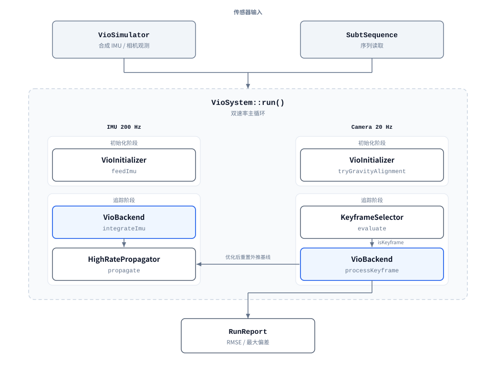

# myslam

[English](README.md) | 简体中文

C++26 实现的视觉惯性里程计（VIO）。后端使用 GTSAM 的 `IncrementalFixedLagSmoother`，
将 IMU 预积分因子与视觉重投影因子放进同一个因子图，按时间窗口边缘化。

- **语言标准**：C++26（由 CMake 强制）
- **依赖**：[GTSAM](https://github.com/borglab/gtsam) 4.3、[mylog](https://github.com/printf033/mylog)、
  [OpenCV](https://github.com/opencv/opencv) 4.x、[MASt3R](https://github.com/naver/mast3r)（均为 submodule）
- **可选依赖**：LuaJIT 2.1（配置加载）；也可用系统安装的 OpenCV 4 替代 submodule
- **版本号**：唯一来源为 `CMakeLists.txt` 的 `project(VERSION)`，运行时经 `myslam::kVersion` 读取

---

## 目录

- [系统架构](#系统架构)
- [数据流](#数据流)
- [模块职责](#模块职责)
- [运行流程](#运行流程)
- [目录结构](#目录结构)
- [环境要求](#环境要求)
- [构建](#构建)
- [运行](#运行)
- [配置系统](#配置系统)
- [数据集回放](#数据集回放)
- [脚本](#脚本)
- [测试](#测试)
- [工程规范](#工程规范)
- [当前限制](#当前限制)

---

## 系统架构

系统由五部分组成，按调用顺序排列：

1. **初始化器** `VioInitializer` — 状态机 `UNINITIALIZED → STATIONARY_COLLECTING →
   GRAVITY_ALIGNED → TRACKING_OK`，异常时进入 `LOST_DEGRADED` 并重建流水线。静止判定同时使用加速度与
   陀螺标准差（阈值随噪声配置与采样率缩放）；重力对齐后执行陀螺零偏标定，输出初始位姿、速度与零偏。
   超过 `system.initTimeout` 仍未满足静止条件时自动放宽为非静止对齐，此时角速度均值混入真实运动，
   不再用作陀螺零偏先验（置零交由后端在线估计）。
2. **关键帧决策** `KeyframeSelector` — 按平均视差、特征留存率、时间保底三项判据决定当前
   相机帧是否作为关键帧进入后端。时间保底判据附加最小三角化视差条件。
3. **后端** `VioBackend` — 组合 `CombinedImuFactor`（IMU 预积分）与 `ProjectionFactor`
   （视觉重投影），由 `IncrementalFixedLagSmoother` 在 `slidingWindowLag` 时间窗口内求解并
   边缘化窗口外状态。视觉残差使用 Huber 核。
4. **外推器** `HighRatePropagator` — 在两次优化之间按 IMU 采样递推状态，并在每次优化后以
   优化结果重置递推基线。
5. **健康监测** `HealthMonitor` — 检查零偏模长、速度模长与活跃观测数，超阈值时返回告警文本。

仿真与真实数据集两条输入路径复用上述全部组件，仅替换传感器来源。

## 数据流



图中两列对应两个采样速率。每列分为初始化与追踪两个阶段：同一列内两个阶段由当前
`SystemState` 决定，互斥执行。蓝色框为同一个 `VioBackend` 实例在两个速率路径上的调用。

主循环由 `VioSystem::run()` 驱动：以 IMU 采样步长推进时间，每次 IMU 到达时更新预积分或外推；
相机帧到达时执行初始化或关键帧决策，关键帧触发后端优化并重置外推基线。

## 模块职责

| 模块 | 职责 |
| :--- | :--- |
| `vio/configHolder.hpp` | 传感器数据结构（`ImuMeasurement` / `CameraFrame` / `FeatureObservation`）与配置结构 `VioConfig` |
| `vio/initializer.hpp` | 初始化状态机 `SystemState` 与静止检测、重力对齐、零偏标定 |
| `vio/keyframe_selector.hpp` | 关键帧决策，返回 `DecisionResult`（是否关键帧、原因、视差、留存率） |
| `vio/backend.hpp` | 因子图构建、三角化、分层外点门控、边缘化、`latestNavState()` |
| `vio/propagator.hpp` | IMU 频率状态递推与基线重置 |
| `vio/health_monitor.hpp` | 零偏、速度、观测数检查，返回 `HealthReport` |
| `vio/simulator.hpp` | 3D 轨迹与 IMU / 相机观测生成，附解析真值 |
| `vio/system.hpp` | 双速率主循环编排、`SystemConfig`、精度评估 |
| `vio/vio.hpp` | 聚合头，包含上述全部组件 |
| `lua_config.hpp` | Lua 配置加载，产出 `ProjectConfig` |
| `log_config.hpp` | mylog C++ API 封装（级别 + 文件输出） |
| `dataset/configHolder.hpp` | 回放配置与统计结构；只含标准库，不含 OpenCV |
| `dataset/intrinsics_file.hpp` | 解析 MASt3R 等外部工具估计的内参文件（纯标准库） |
| `dataset/subt_dataset.hpp` | SubT 序列读取：IMU CSV、相机时间戳、图像索引 |
| `dataset/mei_tracker.hpp` | MEI 模型畸变校正与 GFTT + LK 光流跟踪 |
| `dataset/dataset_runner.hpp` | 真实序列回放编排，复用 VIO 组件 |
| `dataset/visualizer.hpp` | OpenCV 窗口与视频输出 |
| `dataset/ply_export.hpp` | 路标与轨迹导出为 PLY |

`vio/*` 与 `dataset/configHolder.hpp` 不包含 OpenCV 头文件，因此关闭数据集工具时仍可构建并解析配置。

## 运行流程

### 初始化

`VioInitializer::feedImu()` 累积静止样本，同时统计加速度与陀螺标准差。`tryGravityAlignment()`
在样本满足条件后执行：由平均比力方向求 roll/pitch，由陀螺均值估计零偏，输出 `Rot3` 与
`ConstantBias`。`VioSystem` 收到成功后调用 `VioBackend::initializeSystem()` 写入首帧先验，
并将状态置为 `TRACKING_OK`。

### 关键帧与后端

关键帧判定通过后，`VioBackend::processKeyframe()` 依次执行：

1. 用上一关键帧与本关键帧的特征对应关系三角化新路标，视差低于
   `minTriangulationParallaxPx` 的点跳过，深度落在 `[minLandmarkDepth, maxLandmarkDepth]`
   之外的结果丢弃；
2. 以预积分预测位姿计算重投影残差，超过 `maxReprojectionErrorPreopt` 的观测临时拒绝。
   深度区间在这里对**所有**路标无条件生效：它是几何有效性判据而非外点判据，因此不受
   `landmarkGateWarmupObs` 保护期豁免。落在相机后方的路标，其投影雅可比随 1/z 发散，
   单条这样的观测就足以让 Hessian 奇异；
3. 若视觉因子少于 `minVisualFactorsForHealth` **且**近期 IMU 窗口判定设备静止，注入
   零速先验（ZUPT，`zuptWindowSeconds`、`zuptVelocitySigma`）。视觉失明后因子图只剩
   IMU 链，它约束速度的**变化**而不约束速度本身，积分误差因此单调累积、位置按时间平方增长；
4. 插入 `ProjectionFactor` 并调用 smoother 更新，按 `extraSmootherIterations` 追加迭代。
   求解抛 `IndeterminateSystemException` 时，后端以最近一次成功的关键帧为锚点重建平滑器，
   而不是把失败上交：坐标系保持不变，仅该帧不产出位姿；
5. 以优化后位姿重算残差，超过 `maxReprojectionError` 且连续多帧超限者永久标记外点，
   单帧超过 `maxReprojectionErrorHard` 者直接剔除；
6. 检查 `HealthMonitor`，记录告警。`VISUAL` 类降级（观测枯竭，例如图像变暗）**不**重建
   流水线——下一帧图像同样是黑的，重建只会让坐标系反复归零；只有惯性类降级才重建。

关键帧数据同时维护滑动窗口规模统计与固定滞后窗口时长 `slidingWindowLag`。

### 精度评估

`VioSystem::evaluate()` 对关键帧位姿与仿真真值逐帧求平移误差，输出 RMSE 与最大偏差；
RMSE 低于 `rmseThreshold` 时判定通过。

---

## 目录结构

```
myslam/
├── CMakeLists.txt            # 顶层构建、版本号唯一来源、format 目标
├── config/config.lua         # 默认运行配置（构建时复制到 build/config/）
├── src/
│   ├── CMakeLists.txt        # INTERFACE 目标 myslam / myslam_lua / myslam_sanitized
│   ├── myslam.hpp.in         # 版本号模板，configure_file 生成
│   ├── lua_config.hpp        # Lua 配置加载
│   ├── log_config.hpp        # 日志配置
│   ├── vio/                  # VIO 核心，无 OpenCV 依赖
│   └── dataset/              # 数据集回放，OpenCV 仅存在于本层
├── examples/
│   ├── 1_visual_inertial_odometry.cpp   # 仿真运行示例
│   └── 2_subt_dataset.cpp               # 真实数据集回放
├── tests/
│   ├── test_vio.cpp          # VIO 冒烟测试与精度断言
│   └── test_lua_config.cpp   # 配置解析、钳位、交叉校验、失败路径
├── docs/
│   ├── architecture.svg      # 系统架构图（英文）
│   └── architecture_zh.svg   # 系统架构图（中文）
├── scripts/
│   ├── run_subt.sh           # 数据集回放脚本
│   ├── plot_tum.py           # TUM 轨迹绘图
│   ├── gen_architecture_svg.py  # 生成 docs/ 下的架构图
│   └── setup-hooks.sh        # 安装 pre-commit 格式化钩子
└── thirdparty/              # gtsam / mylog / opencv / mast3r（git submodule）
```

---

## 环境要求

| 项目 | 要求 |
| :--- | :--- |
| CMake | ≥ 3.20 |
| 编译器 | 支持 `-std=c++26`（GCC 14+） |
| 构建工具 | Ninja 或 Make |
| 系统库 | TBB、Boost、Eigen3、Threads |
| LuaJIT | 2.1+ 且可被 `pkg-config` 发现；缺失时 Lua 支持自动关闭，其余功能不受影响 |
| MASt3R | 仅 `--init mast3r` 需要：PyTorch 环境 + 权重；否则完全不需要 |
| OpenCV | 4.x，仅 `MYSLAM_BUILD_DATASET_TOOLS=ON` 时需要；默认用系统包，`MYSLAM_USE_BUNDLED_OPENCV=ON` 时改用 `thirdparty/opencv` 子模块 |
| clang-format | 23.1.3（提交钩子与 CI 按此版本校验） |

Ubuntu 安装：

```bash
sudo apt-get install -y build-essential cmake ninja-build pkgconf \
    libtbb-dev libboost-all-dev libeigen3-dev libluajit-5.1-dev
# 仅数据集工具需要（系统 OpenCV 后端；用 MYSLAM_USE_BUNDLED_OPENCV 时可跳过）
sudo apt-get install -y libopencv-dev
# 格式化工具
pipx install "clang-format==23.1.3"
```

---

## 构建

```bash
git clone --recursive <repo-url> myslam
cd myslam

cmake -B build -G Ninja \
    -DCMAKE_BUILD_TYPE=Debug \
    -DCMAKE_EXPORT_COMPILE_COMMANDS=ON

cmake --build build -j"$(nproc)"
ctest --test-dir build --output-on-failure
```

首次构建会编译 GTSAM。只构建核心时可跳过约 225 MB 的 `thirdparty/opencv` 与
`thirdparty/mast3r`，改用 `git submodule update --init thirdparty/gtsam thirdparty/mylog`。

### 构建选项

| 选项 | 默认 | 说明 |
| :--- | :--- | :--- |
| `MYSLAM_BUILD_EXAMPLES` | 顶层构建时 `ON` | 构建示例程序 |
| `MYSLAM_BUILD_TESTS` | 顶层构建时 `ON` | 构建测试 |
| `MYSLAM_BUILD_DATASET_TOOLS` | `OFF` | 构建 OpenCV 数据集回放工具 |
| `MYSLAM_USE_BUNDLED_OPENCV` | `OFF` | 从 `thirdparty/opencv` 子模块构建 OpenCV，不再使用系统包 |
| `MYSLAM_SANITIZE` | 顶层构建时 `ON` | Debug 下启用 ASan/UBSan |
| `MYSLAM_ENABLE_LUA` | `ON` | Lua 配置支持；找不到 LuaJIT 时自动降为 `OFF` 并给出告警 |

经 `add_subdirectory` 引入时，上述开关默认改为 `OFF`。

### 数据集工具的独立构建

Debug + ASan 下关键帧优化耗时较长，数据集回放使用单独的 Release 构建：

```bash
cmake -B build-release -G Ninja \
    -DCMAKE_BUILD_TYPE=Release \
    -DMYSLAM_SANITIZE=OFF \
    -DMYSLAM_BUILD_TESTS=OFF \
    -DMYSLAM_BUILD_DATASET_TOOLS=ON
cmake --build build-release --target 2_subt_dataset -j"$(nproc)"
```

`scripts/run_subt.sh` 默认使用 `build-release`。

### 内置 OpenCV

`thirdparty/opencv` 是钉在 4.x 分支上的子模块，数据集工具可以直接针对随仓库演进的版本构建，
而不必依赖宿主发行版装的 OpenCV：

```bash
cmake -B build-release -G Ninja \
    -DCMAKE_BUILD_TYPE=Release \
    -DMYSLAM_SANITIZE=OFF \
    -DMYSLAM_BUILD_TESTS=OFF \
    -DMYSLAM_BUILD_DATASET_TOOLS=ON \
    -DMYSLAM_USE_BUNDLED_OPENCV=ON
cmake --build build-release --target 2_subt_dataset -j"$(nproc)"
```

只配置回放工具真正用到的模块（`core`、`imgproc`、`imgcodecs`、`features2d`、`video`、
`calib3d`、`highgui`、`videoio`），并关闭测试、示例、Python/Java 绑定与可选编解码器
（JPEG2000、TIFF、OpenEXR、GDAL、gPhoto2）。首次 configure 会从源码编译这些模块，
耗时明显长于系统包后端。

两种来源都暴露同一个 `myslam::opencv` 接口目标，消费方无需区分。跟随上游更新：
`git submodule update --remote thirdparty/opencv`。

### MASt3R

`thirdparty/mast3r` 钉住 [naver/mast3r](https://github.com/naver/mast3r) —— SubT 序列背后的三维重建工具链。
它是 Python/PyTorch 项目，不参与 C++ 编译；但在**运行期**是可选依赖：`2_subt_dataset --init mast3r`
会调用 `scripts/mast3r_intrinsics.py`，从图像估计内参（见[内参来源](#内参来源)）。不开启时
完全不受影响。

跟随上游更新：`git submodule update --remote thirdparty/mast3r`。跑估计前需要先拉取嵌套的
dust3r：`git submodule update --init --recursive thirdparty/mast3r`。

### 版本号

版本字符串只在 `project(VERSION ...)` 出现一次，`configure_file` 将其写入
`<build>/src/generated/myslam.hpp`。修改版本号后重新构建即可。

### 格式化

```bash
cmake --build build --target format        # 就地格式化
cmake --build build --target format-check  # 仅检查
```

`scripts/setup-hooks.sh` 安装 pre-commit 钩子，未格式化代码无法提交。

---

## 运行

### 仿真

```bash
cd build
./bin/1_visual_inertial_odometry
```

按默认配置运行 5 秒仿真（IMU 200 Hz / 相机 20 Hz），输出：

```
评估关键帧样本数 : 24
整体平移 RMSE 误差: 0.0365 米
最大轨迹偏差       : 0.0778 米
```

退出码 `0` 表示 RMSE 低于 `system.rmseThreshold`（默认 0.20 m）。

日志写入**当前工作目录**的 `.log` 文件（由 mylog 的 `FileManager` 管理），终端只输出
`[info] 已加载配置: ...`。结果需打开日志文件查看。

### 指定配置文件

```bash
./bin/1_visual_inertial_odometry                        # 读 config/config.lua，缺失则用内置默认值
./bin/1_visual_inertial_odometry my_config.lua          # 显式指定；加载或校验失败退出码 1
```

---

## 配置系统

运行期参数由 Lua 脚本提供，默认文件 `config/config.lua`，构建时复制到 `build/config/`。

### 配置节

| 节 | 消费方 | 内容 |
| :--- | :--- | :--- |
| `vio` | `VioConfig` | 相机内参、外参、IMU 噪声、Huber 核阈值、关键帧策略、滑动窗口 |
| `system` | `SystemConfig` | 相机步长、运行时长、RMSE 门限 |
| `dataset` | `MeiIntrinsics` / `DatasetRunConfig` | 数据集内参、回放范围、可视化开关 |
| `logger` / `fileManager` | mylog | 日志级别、缓冲、滚动与保留策略 |

字段均可省略，省略时保留代码内置默认值。

### 加载机制

- 脚本在未注册标准库的裸 `lua_State` 中执行，`io`/`os`/`package`/`debug` 不可用；
  另有指令预算（`kInstructionBudget`，5000 万条）。
- 先解析到临时副本，全部校验通过后写回 `ProjectConfig`；任一步失败则保持调用方原配置。
- 越界分两类：调参类字段钳位到安全区间并告警；焦距、针孔缩放、图像尺寸等硬前提字段
  直接判非法，不自动纠正。
- 配置节中出现未登记键时逐条告警。
- 交叉约束校验：关键帧间隔上下界、重投影门限的相对关系、相机与 IMU 采样率关系。

### 派生量

IMU 采样步长不是配置项，由 `vio.imuRateHz` 派生：

```cpp
const double imuDt = vio::SystemConfig::imuDtFrom(config_.imuRateHz);  // 1 / imuRateHz
```

旧配置中残留的 `system.imuDt` 会输出迁移提示。

### 代码中加载

```cpp
#include "lua_config.hpp"

myslam::config::ProjectConfig project;
const auto result = myslam::config::load("config/config.lua", project, /*applyLogging=*/true);

if (!result) { /* 沿用内置默认值；result.error().message 说明原因 */ }
else if (!result->logging) { /* 回退到 mylog C++ API */ }
```

未链接 `myslam::myslam_lua` 时该头文件为桩实现，`load()` 返回失败。

---

## 数据集回放

`2_subt_dataset` 使用与仿真相同的 VIO 组件，仅替换传感器来源。数据布局：

```
Handheld1_Folder/
├── cam_0/
│   ├── 0.png, 1.png, ...
│   └── timestamps.txt      # 每行一个纳秒时间戳
└── imu/
    └── imu_data.csv        # timestamp, q_x, q_y, q_z, q_w,
                            # ang_vel_{x,y,z}, lin_acc_{x,y,z}
```

### 针对该数据集的处理

**MEI 相机模型**：后端以 `gtsam::Cal3_S2` 做重投影，而该序列使用 MEI 模型。`MeiFeatureTracker`
先用 radtan 模型反解畸变，再按 MEI 模型反投影为射线，最后以 `pinholeScale` 缩放的虚拟针孔
内参投回像素平面。虚拟内参同步写入 `VioConfig`。

**IMU 时间断档**：相邻样本间隔超过 `maxImuGapFactor / imuRateHz` 时判定为断层（默认 10 倍采样
周期，200 Hz 下为 50 ms，可在 `dataset.replay.maxImuGapFactor` 调整）。断档处理有两条规则：

- 零阶保持不跨越缺口：断档区间没有 IMU 数据，预积分停在该样本后一个采样周期处，不会把
  最后一条测量外推整段缺失时间；
- 重建流水线并重新初始化。段数计入 `DatasetRunReport::segments`，重置次数计入 `resets`。

各段独立从局部原点重新初始化，坐标系互不相同，因此**轨迹与点云不可跨段直接拼接**。TUM
输出在段边界写入 `#` 注释行作为标记（`plot_tum.py` 会跳过），段数大于 1 时报告会给出提示。

预积分边界与相机时刻严格对齐：相机时刻通常落在两条 IMU 样本之间，积分在 `cameraTime`
处按比例截断，跨越边界的样本只消费前半段，剩余留给下一帧，因此 `CombinedImuFactor` 覆盖的
区间末端与关键帧时间戳一致。

### 用法

```bash
build-release/bin/2_subt_dataset \
    --data  /path/Handheld1_Folder/cam_0 \
    --imu   /path/Handheld1_Folder/imu/imu_data.csv \
    --stamps /path/Handheld1_Folder/cam_0/timestamps.txt \
    [--output traj.tum] [--start-frame N] [--max-frames N] [--stride N] \
    [--max-features N] [--max-duration S] [--ply cloud.ply] \
    [--viz] [--video out.mp4] [--viz-stride N] [--viz-rate R] \
    [--config config/config.lua] \
    [--init manual|mast3r] [--intrinsics-file FILE]
```

`--config` 提供基线默认值，命令行参数优先。未指定时读取当前目录的 `config/config.lua`，
不存在则使用内置默认值。

`--fx/--fy/--cx/--cy/--xi/--k1/--k2/--p1/--p2/--width/--height/--pinhole-scale` 可逐项覆盖
MEI 内参。

### 内参来源

没有标定文件的序列可以不填任何相机参数，让 MASt3R 从图像估计：

```bash
scripts/run_subt.sh --init mast3r          # 或 2_subt_dataset ... --init mast3r
```

流程：

1. 默认采样 6 对图像（`--mast3r-pairs`）送入 `thirdparty/mast3r` 的 MASt3R 模型，
   用 `estimate_focal_knowing_depth` 从预测点图恢复焦距，主点取图像中心；
2. 结果写成 `<cam_0>/../mast3r_intrinsics.txt` 并缓存，后续回放直接复用；
   `--force-estimate` 强制重算，`--mast3r-cache` 可改缓存位置；
3. 解析后只把结果用于**虚拟针孔焦距**：`pinholeScale = focal / fx`，使后端的
   `pinholeFx()` 等于估计值。`xi` 与 `k1/k2/p1/p2` **从配置的内参继承**，
   鱼眼反投影照常进行——这一点很关键。

#### 为什么不能直接把估计值当 fx 用

估计值是从针孔假设下拟合出的**有效针孔焦距**，而 MEI 的 `fx` 是投影参数：
Handheld1 的 `fx = 758.3`、`xi = 1.583`，其近轴等效针孔焦距只有
`fx / (1 + xi) ≈ 294`。早期实现把 `focal = 408` 写进 `fx` 并把 `xi` 清零，
等价于“把鱼眼原图当针孔图用”：`mx/mz = x` 使像素映射退化为恒等，畸变反解被旁路，
有效视场掩码从 54.7% 变成 99.8%。鱼眼镜头的**圆形机械边框**是高对比度强角点，
GFTT 于是把特征全堆在边框上，光流把跟踪预算花在无法三角化的边缘，轨迹尺度
偏大一倍以上。保留 `xi` 后，`meiToPinhole` 的 `mz <= 1e-6` 与越界判据会把边框
自动挡在掩码外。

推理需要 PyTorch 环境：用 `--python`、`MYSLAM_PYTHON` 或 `scripts/run_subt.sh` 的
`MAST3R_PYTHON` 指向它（例如 conda 的 `mast3r` 环境），权重用 `--mast3r-weights` 或
`MAST3R_WEIGHTS` 指定，默认在 `thirdparty/mast3r/checkpoints/` 下查找。

两点限制：

- MASt3R 输出的是**针孔模型**，对 >180° 视场的 MEI 鱼眼图只能给出近似焦距（实测 Handheld1
  在 400–500 px 之间波动）。它无法恢复 `xi` 或畸变系数，因此新序列的镜头特性仍需在
  `dataset.intrinsics` 中说明；需要准确内外参的精度评估仍应使用 yaml 标定值；
- 自动估计只覆盖焦距。相机-IMU 外参 `Tic` 同样仍需内置值或标定文件。

已有估计结果的机器可以跳过推理，直接 `--intrinsics-file result.txt`（格式见
`src/dataset/intrinsics_file.hpp`）：

```
model = pinhole
source = mast3r
focal = 495.90
cx = 320.0
cy = 240.0
width = 640
height = 480
```

`focal` 是后端虚拟针孔焦距，不是 MEI 的 `fx`。文件中未出现的 `xi`/`k1`/`k2`/`p1`/`p2`
一律从配置继承；写了 `fx`/`fy` 会被拒绝（旧版缓存因此会自动失效并重算）。

### 可视化

- `--viz`：OpenCV 窗口（需要 `DISPLAY`，ESC/q 退出）
- `--video FILE`：编码为视频（mp4 不可用时回退 `.avi`/MJPG）
- `--viz-rate R`：`0` 全速、`1` 实时、`2` 两倍速

画面布局：上方为原图与特征点（绿色=跨帧跟踪成功，橙色=本帧新增），下方状态栏左侧为轨迹
小地图，右侧为运行状态。

### 轨迹查看

```bash
scripts/plot_tum.py traj.tum --save traj.png          # 3D / XY 俯视 / 位置速度三联图
scripts/plot_tum.py traj.tum --ply cloud.ply --show
```

PLY 点云可用 MeshLab / CloudCompare / Open3D 打开。

---

## 脚本

### `scripts/run_subt.sh`

```bash
scripts/run_subt.sh                          # 默认序列，从第 2300 帧起
scripts/run_subt.sh --max-frames 0           # 跑完剩余全部帧
scripts/run_subt.sh --root /path/Handheld2_Folder
scripts/run_subt.sh --viz                    # 实时窗口
scripts/run_subt.sh --video out.avi --ply cloud.ply
scripts/run_subt.sh --plot                   # 回放后绘图
scripts/run_subt.sh --no-build               # 跳过编译
scripts/run_subt.sh --init mast3r            # 用 MASt3R 估计内参
```

默认序列路径为 `../MASt3R-Fusion/dataset/Handheld1_Folder`，可用 `--root` 或 `SUBT_ROOT` 覆盖。
默认从第 2300 帧开始（该序列前段存在曝光跳变与 IMU 断档）。未指定 `--max-frames` 时脚本使用
`500000`。

`--init mast3r` 会透传给回放工具，并把 `MAST3R_PYTHON` 导出为 `MYSLAM_PYTHON`，
让 MASt3R 推理在你指定的解释器里运行。

### `scripts/plot_tum.py`

需要 `numpy` 与 `matplotlib`。输出 3D 轨迹、XY 俯视、位置与速度随时间变化三张子图。

### `scripts/setup-hooks.sh`

安装 `.githooks/pre-commit`（`git config core.hooksPath .githooks`），以
`clang-format --dry-run -Werror` 校验暂存文件。

---

## 测试

```bash
ctest --test-dir build --output-on-failure
```

| 测试 | 覆盖内容 |
| :--- | :--- |
| `myslam_test` | 公开 API 可用、关键帧非空、RMSE 在门限内、派生步长有效 |
| `myslam_config_test` | 解析、钳位、交叉校验、未知键、四元数单位化、失败路径、日志节生效、默认配置自洽 |
| `myslam_intrinsics_test` | 内参估计文件：focal 落到虚拟针孔、畸变从基线继承、旧版 fx 字段被拒、主点回退与各类非法输入 |

CI（`.github/workflows/ci.yml`）在 Ubuntu 上使用 `g++-14` 执行格式检查、构建与测试，
`clang-format` 固定为 23.1.3。

---

## 工程规范

规范来自 mylog 子库，完整说明见项目 `instructions.md`。

- C++26，4 空格缩进，Allman 大括号，120 列
- 类型 `CamelCase`；函数与局部变量 `camelBack`；成员变量 `_` 后缀
- 常量 `k` 前缀 + `CamelCase`；枚举与宏 `UPPER_CASE`；命名空间 `lower_case`
- 构建开关前缀 `MYSLAM_*`；测试目标 `myslam_test`
- Doxygen 注释；提交前通过 clang-format

---

## 当前限制

- 不含回环检测与全局重定位，误差随时间累积。
- 不含地图持久化，路标随边缘化窗口回收。
- 仅支持单目相机 + IMU，无多相机、深度或 GNSS 融合。
- 无 `install()` 与 `export()` 规则；`myslam` 是 INTERFACE 目标，`INSTALL_INTERFACE` 为预留，
  生成的头文件未安装。
- 配置在启动时一次性加载，无运行期热重载。
- 日志写入当前工作目录，未按项目路径归档。
- 若环境中存在遮蔽系统 `libfontconfig` 的前缀（如 conda），数据集工具运行时会报
  `undefined symbol: FcConfigSetDefaultSubstitute`，可用
  `LD_LIBRARY_PATH=/usr/lib/x86_64-linux-gnu` 覆盖。
